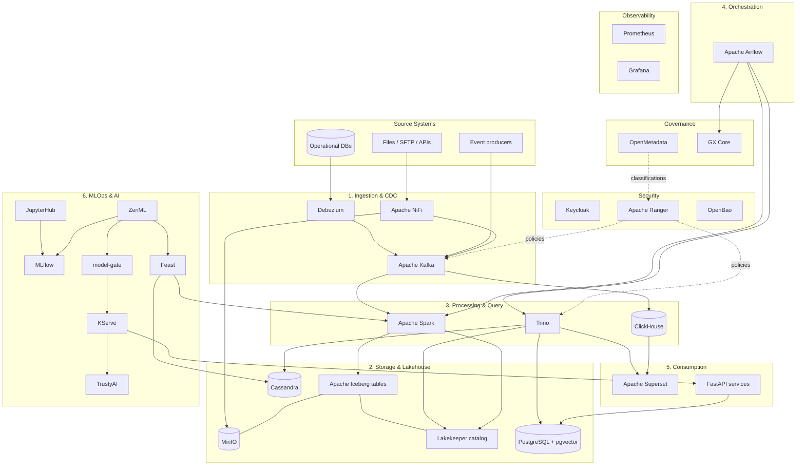
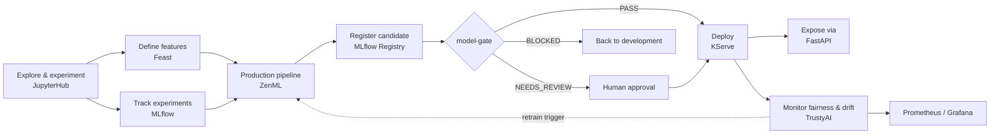
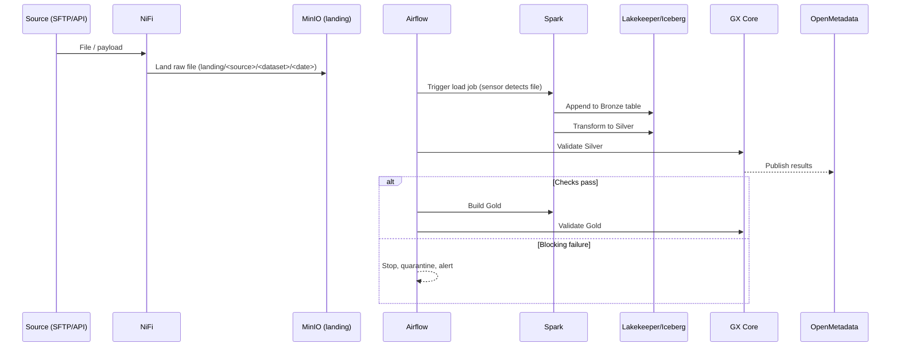
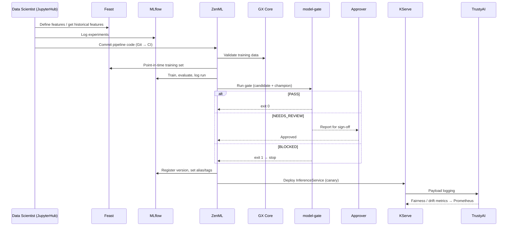

# BDP: Component Architecture and Integration Guide

| Item | Detail |
|---|---|
| Document type | Architecture reference and integration guide |
| Audience | Data engineers, ML engineers, platform engineers, BI developers, solution architects |
| Scope | Approved baseline technology stack of the BDP Data & AI Platform |
| Status | Baseline v1.1 |
| Date | 18 November 2026 |
| Platform foundation | RKE2 (Rancher Kubernetes Engine 2) |

**Change log**

| Version | Change |
|---|---|
| 1.0 | Initial baseline guide. |
| 1.1 | Added Apache Ranger as a baseline component (Section 5.1.2). Added a "Dependent components" table to every component. Added RKE2 as the platform foundation (Section 2.4) and a consolidated dependency register (Section 8.2). Updated flows, matrix, ownership, gaps and checklists. Corrected the ZenML database dependency and flagged the MinIO edition decision. |

---

## Table of Contents

1. [Purpose and How to Use This Guide](#1-purpose-and-how-to-use-this-guide)
2. [Platform Architecture at a Glance](#2-platform-architecture-at-a-glance) — including [2.4 Platform Foundation: RKE2](#24-platform-foundation-rke2)
3. [Platform-Wide Rules Every Developer Must Follow](#3-platform-wide-rules-every-developer-must-follow)
4. [Part A – Big Data and Data Engineering Stack](#4-part-a--big-data-and-data-engineering-stack)
5. [Part B – Platform Security and Observability](#5-part-b--platform-security-and-observability)
6. [Part C – MLOps and AI Engineering Stack](#6-part-c--mlops-and-ai-engineering-stack)
7. [End-to-End Integration Flows](#7-end-to-end-integration-flows)
8. [Component Integration Matrix and Dependency Register](#8-component-integration-matrix-and-dependency-register)
9. [Ownership and Responsibility Model](#9-ownership-and-responsibility-model)
10. [Known Gaps and Open Architecture Decisions](#10-known-gaps-and-open-architecture-decisions)
11. [Developer Onboarding Checklist](#11-developer-onboarding-checklist)
12. [Glossary](#12-glossary)

---

## 1. Purpose and How to Use This Guide

### 1.1 Why this guide exists

The BDP platform is made up of 28 open-source baseline components. They run on an RKE2 Kubernetes foundation and rely on a set of dependent components (databases, operators, search engines, caches) that they need in order to work. Each one is good at a narrow job. The value of the platform comes from how they are wired together: data lands once, is described once, is secured once, and is reused by analytics and AI without being copied around.

When developers do not understand the role of a component, the usual results are:

- the same data stored in three places with three different definitions;
- credentials hard-coded in notebooks and DAGs;
- models deployed without the governance checks the business has signed up to;
- pipelines that nobody can trace when something breaks.

This guide tells you **what each component is for, what it must connect to, and what you are expected to do (and not do) when you work with it.** It is not an installation or configuration manual. Product documentation and the platform runbooks cover the "how"; this guide covers the "what" and the "why".

### 1.2 How each component section is structured

Every component in Sections 4–6 follows the same pattern:

| Heading | What it tells you |
|---|---|
| **Role in BDP** | The job this component does on this platform (not everything the product can do). |
| **Why it matters** | What breaks or degrades if it is bypassed or misused. |
| **Integrates with** | The components it must connect to, and the direction of the connection. |
| **Dependent components** | What the component needs in order to run (databases, operators, runtimes, libraries), and whether that dependency is already in the approved baseline. |
| **Developer guidance** | Concrete do's and don'ts. |

### 1.3 Reading paths

| If you are a… | Read first |
|---|---|
| Data engineer | Sections 2, 3, 4, 7.1–7.3 |
| BI / analytics developer | Sections 2, 3, 4.3, 4.6, 7.4 |
| ML / AI engineer | Sections 2, 3, 6, 7.5–7.7 |
| Platform / DevOps engineer | Sections 2 (especially 2.4 RKE2), 3, 5, 8.2, 10 |
| Solution architect | Entire document |

---

## 2. Platform Architecture at a Glance

### 2.1 Logical layers

The platform is organised into seven functional layers, wrapped by two cross-cutting layers (security and observability) and one governance layer (metadata and quality).

> **Foundation:** every component above runs as containerised workloads on the **RKE2** Kubernetes platform (Section 2.4), unless an approved exception is recorded.

### 2.2 The layers in plain terms

| Layer | Components | What it does for the platform |
|---|---|---|
| 1. Ingestion & CDC | NiFi, Debezium, Kafka | Gets data off source systems reliably, in batch and real time. |
| 2. Storage & Lakehouse | MinIO, Iceberg, Lakekeeper, Cassandra, PostgreSQL + pgvector | Stores data once, in open formats, with a single catalog of tables. |
| 3. Processing & Query | Spark, Trino, ClickHouse | Transforms data at scale, queries it interactively and serves fast analytics. |
| 4. Orchestration | Airflow | Schedules and sequences every data job, with retries and dependencies. |
| 5. Consumption | Superset, FastAPI | Puts data and models in front of business users and applications. |
| 6. MLOps & AI | JupyterHub, MLflow, ZenML, Feast, model-gate, KServe, TrustyAI | Takes models from experiment to governed production and monitors them. |
| Governance | OpenMetadata, GX Core | Describes, classifies, traces and quality-checks every data asset. |
| Security | Keycloak, Apache Ranger, OpenBao | One identity for every user and service; one place to define and audit fine-grained data access policies; no secrets in code. |
| Observability | Prometheus, Grafana | One place to see the health of every component and pipeline. |
| Foundation | RKE2 (Kubernetes) | Runs, schedules, scales, isolates and heals every platform workload. |

### 2.3 The medallion data zones

All analytical data in the lakehouse follows three zones. Every Iceberg table must belong to exactly one.

| Zone | Contents | Written by | Read by |
|---|---|---|---|
| **Bronze (raw)** | Data as received, append-only, with ingestion metadata (source, load time, batch/offset). | Spark (from Kafka and from NiFi landing files) | Spark only |
| **Silver (conformed)** | Cleaned, de-duplicated, typed, conformed to enterprise keys; CDC applied (current-state and history tables). | Spark | Spark, Trino, Feast, data scientists |
| **Gold (curated)** | Business-ready models: facts, dimensions, aggregates, feature tables, data products. | Spark (heavy builds) or Trino (SQL builds) | Trino, Superset, ClickHouse, Feast, APIs |

A raw **landing area** in MinIO (outside Iceberg) holds files dropped by NiFi before Spark loads them into Bronze.

### 2.4 Platform Foundation: RKE2

#### 2.4.1 Role in BDP

**RKE2** (Rancher Kubernetes Engine 2, from SUSE Rancher) is the Kubernetes distribution on which the **entire BDP platform is deployed**. Every baseline component runs as containerised workloads (Deployments, StatefulSets, or custom resources managed by Kubernetes operators) on RKE2 clusters.

RKE2 is a security-focused, CNCF-conformant distribution. It ships hardened defaults aligned to the CIS Kubernetes Benchmark, supports FIPS-validated cryptography, uses containerd as the container runtime and embedded etcd for cluster state, and deploys core add-ons (network plugin, CoreDNS, metrics-server, ingress controller) as Helm charts that RKE2 manages itself.

#### 2.4.2 Why it matters

- **One way to run 28 components.** Deployment, scaling, self-healing, upgrades and recovery work the same way for every component.
- **Security baseline for regulated data.** Hardened profile, Pod Security Admission, network policies and encryption of Kubernetes secrets at rest are available from day one.
- **Operators automate stateful services.** PostgreSQL, Kafka, Cassandra, ClickHouse, KServe and TrustyAI are run by Kubernetes operators that handle failover, scaling and upgrades.
- **Elastic compute.** Spark executors, notebooks and model servers scale up and down on shared node pools, including GPU scheduling.
- **On-premises and air-gapped friendly.** RKE2 supports air-gapped installation with private registries, which suits enterprise data-centre deployments.

#### 2.4.3 Foundation services

RKE2 provides the Kubernetes core. Other cluster services are **dependencies of the platform** and must be approved as part of the foundation (see G12).

| Capability | Provided by | In baseline? | Used by |
|---|---|---|---|
| Control plane and cluster state | RKE2 servers with embedded etcd (3 server nodes for HA) | Yes (RKE2) | All |
| Container runtime | containerd (bundled with RKE2) | Yes | All |
| Pod networking and network policies | RKE2-bundled CNI: Canal (default), Calico or Cilium — choose one | Yes | Namespace and domain isolation |
| DNS and resource metrics | CoreDNS and metrics-server (bundled) | Yes | Service discovery, autoscaling |
| Ingress | Traefik — the RKE2 default for new clusters from v1.36 (upstream ingress-nginx was retired in March 2026) | Yes | UIs and APIs: Superset, Airflow, Grafana, JupyterHub, OpenMetadata, FastAPI, KServe |
| Load balancer (bare metal) | MetalLB or kube-vip | No – to be confirmed | Exposing ingress and services |
| Persistent storage | A CSI driver for dynamic volumes (e.g. Longhorn) plus local persistent volumes for disk-heavy stateful services | No – to be confirmed | PostgreSQL, Kafka, Cassandra, ClickHouse, MinIO, OpenBao, NiFi, JupyterHub |
| Volume snapshots | snapshot-controller (bundled) with CSI support | Partly | Backups |
| Certificates | cert-manager, using OpenBao PKI as the issuer | No – required | KServe, operator webhooks, TLS for every service |
| Secrets delivery into pods | External Secrets Operator, or OpenBao Agent Injector / CSI provider — choose one | No – required | All workloads (Rule R3) |
| Container registry | Private registry (e.g. Harbor), configured as an RKE2 registry mirror | No – required | Spark job images, ZenML step images, notebook images, FastAPI and model-server images |
| GitOps / continuous delivery | Fleet (Rancher) or Argo CD | No – to be confirmed | Rule R9 |
| Cluster management (optional) | Rancher Manager | No – optional | Multi-cluster management, RBAC with Keycloak |
| GPU enablement | NVIDIA GPU Operator | No – if GPUs are used | KServe, JupyterHub GPU profiles, training |
| Backup and DR | RKE2 etcd snapshots (can target S3-compatible storage) plus Velero for namespaces and volumes | Partly | Cluster and application recovery |
| Kubernetes API authentication | OIDC with Keycloak | Yes (Keycloak) | Engineer access via kubectl/Helm |
| Cluster monitoring | Prometheus Operator stack (kube-state-metrics, node-exporter) | Prometheus/Grafana yes; operator no | Rule R8 (RKE2 control-plane metrics may need explicit configuration to be scraped) |

#### 2.4.4 Recommended cluster layout

**Clusters:** at minimum, production runs on its own RKE2 cluster, separate from development and test.

**Node pools** (separated with labels and taints):

| Node pool | Typical workloads | Characteristics |
|---|---|---|
| Server (control plane) | RKE2 servers, etcd | 3 nodes; no user workloads |
| Platform services | Keycloak, Ranger, OpenBao, Airflow, OpenMetadata, Superset, MLflow, ZenML, Prometheus, Grafana | General purpose |
| Data processing | Spark executors, Trino workers, NiFi | CPU/memory heavy; autoscaling |
| Data storage | MinIO, Kafka, Cassandra, ClickHouse, PostgreSQL | Local SSD/NVMe; anti-affinity; stable nodes |
| ML / GPU | KServe model servers, JupyterHub GPU profiles, training | GPUs; tainted so only ML workloads land here |

**Namespaces** (indicative; domain teams also get their own namespaces, e.g. `<domain>-jobs`, `<domain>-serving`):

| Namespace | Contents |
|---|---|
| `bdp-ingest` | NiFi, Kafka, Kafka Connect / Debezium, schema registry |
| `bdp-storage` | MinIO, Lakekeeper, OpenFGA, Cassandra, PostgreSQL clusters |
| `bdp-processing` | Spark operator and jobs, Trino, ClickHouse |
| `bdp-orchestration` | Airflow |
| `bdp-governance` | OpenMetadata and its search engine |
| `bdp-bi` | Superset |
| `bdp-security` | Keycloak, Apache Ranger, OpenBao |
| `bdp-observability` | Prometheus, Alertmanager, Grafana |
| `bdp-ml` | JupyterHub, MLflow, ZenML, Feast, TrustyAI |
| `bdp-serving` | KServe InferenceServices, FastAPI services |

#### 2.4.5 Developer guidance

- **Do** deploy only through approved Helm charts or operator resources, stored in Git and applied by the CD pipeline.
- **Do** set CPU/memory requests and limits, and use node selectors/tolerations to land on the right node pool.
- **Do** build containers that run as non-root and comply with the cluster's Pod Security standard (the RKE2 CIS profile enforces restrictive defaults).
- **Do** define NetworkPolicies for your namespace (default deny, then allow only what is needed).
- **Do** pull images only from the internal registry, and only images that have passed scanning.
- **Do** expose UIs and APIs through the standard ingress class (Traefik), with TLS certificates from cert-manager.
- **Don't** use hostPath volumes, privileged pods or host networking without an approved exception.
- **Don't** run `kubectl apply` by hand against test or production clusters.
- **Don't** keep state on a pod's ephemeral storage; anything that must survive a restart goes to a persistent volume, MinIO or a database.

---

## 3. Platform-Wide Rules Every Developer Must Follow

These rules apply regardless of which component you are working on. They are the reason the components are integrated the way they are.

| # | Rule | Why |
|---|---|---|
| R1 | **Store analytical data once, in Iceberg on MinIO, registered in Lakekeeper.** Do not create private copies in other stores unless the use case is approved for Cassandra, ClickHouse or PostgreSQL. | One version of the truth; governance and access control apply in one place. |
| R2 | **Every identity comes from Keycloak.** No local user accounts in any tool except emergency break-glass accounts held by the platform team. | Single sign-on, single offboarding, consistent audit. |
| R3 | **Every secret comes from OpenBao.** No passwords, keys or tokens in code, notebooks, DAGs, images or Git. | Secrets can be rotated and revoked without code changes. |
| R4 | **Every scheduled job runs from Airflow** (or from ZenML for ML pipelines). No cron jobs, no "run from my laptop". | Dependencies, retries, alerting and lineage are only possible when orchestration is central. |
| R5 | **Every dataset that others consume must be in OpenMetadata** with an owner, a description, a domain and a classification (e.g. PII, Confidential). | People can find, trust and correctly protect data. |
| R6 | **Every Silver and Gold dataset must have GX Core checks** that run in its pipeline and publish results. | Bad data is stopped before it reaches reports and models. |
| R7 | **Every model goes through model-gate before deployment.** Only `PASS` (or `NEEDS_REVIEW` with recorded human approval) may be deployed to KServe. | Responsible AI and regulatory obligations are enforced, not hoped for. |
| R8 | **Every component exposes metrics to Prometheus** and has a Grafana dashboard and alert rules before go-live. | Problems are seen before users report them. |
| R9 | **Everything is code.** Pipelines, DAGs, expectation suites, dashboards definitions, Keycloak realms/clients, Lakekeeper permissions and KServe manifests live in Git and are deployed via CI/CD. | Changes are reviewed, repeatable and reversible. |
| R10 | **Use open table and protocol standards** (Iceberg, Iceberg REST catalog, S3 API, OIDC, Kafka protocol). Do not introduce proprietary formats. | Components remain swappable; no lock-in. |
| R11 | **Fine-grained data access is defined in Apache Ranger.** Table, column, row-filter, masking and topic policies for Trino and Kafka are created in Ranger against directory/Keycloak groups, never as ad-hoc grants inside the tools. | One policy model, one audit trail, consistent enforcement. |
| R12 | **Everything runs on RKE2 through approved Helm charts or operators.** No manually created resources in shared clusters, and no workloads outside the cluster without an approved exception. | Consistent deployment, hardening, scaling and recovery. |

---

## 4. Part A – Big Data and Data Engineering Stack

### 4.1 Data Ingestion and Change Data Capture

#### 4.1.1 Apache NiFi

**Role in BDP**
NiFi is the platform's **batch, file and API ingestion engine**. It pulls or receives data from sources that are not databases with change logs: SFTP drops, flat files, REST/SOAP APIs, partner feeds, legacy systems and IoT gateways. It routes, lightly validates and enriches data in flight, then delivers it to the landing area in MinIO or to Kafka topics.

**Why it matters**
Without NiFi, every team writes its own file-transfer scripts. NiFi gives visual, auditable flows with built-in back-pressure, retry and **data provenance** (a record of where each piece of data came from and what happened to it).

**Integrates with**

| Component | Direction | Purpose |
|---|---|---|
| Source systems | Inbound | Pull/receive files, API payloads, messages. |
| MinIO | Outbound | Land raw files in the landing area (S3 API). |
| Kafka | Outbound | Publish records/events to topics for streaming consumers. |
| Keycloak | Auth | OIDC login to the NiFi UI; group-based policies. |
| OpenBao | Secrets | Source credentials, API keys, MinIO/Kafka credentials via parameter providers. |
| Airflow | Control (optional) | Airflow can trigger or check NiFi flows via the NiFi REST API when a batch must be coordinated with downstream jobs. |
| OpenMetadata | Metadata | Document ingestion pipelines and their target datasets. |
| Prometheus / Grafana | Monitoring | Flow throughput, queue depth, back-pressure, failures. |

**Dependent components**

| Dependency | Need | In baseline? | Notes |
|---|---|---|---|
| NiFi Registry, or a Git-backed flow registry client | Recommended | No – to be confirmed | Versions flows and promotes them between environments. |
| Cluster coordination: ZooKeeper, or Kubernetes-native leader election and state (NiFi 2.x) | Required for clustered NiFi | Design choice | Prefer the Kubernetes-native option on RKE2 to avoid running ZooKeeper. |
| Persistent volumes for FlowFile, content and provenance repositories | Required | Foundation (RKE2 storage) | Fast disks; size for provenance retention. |
| Kubernetes packaging (Helm chart) | Required | No – platform team build | No official Apache operator is assumed. |
| Kafka, MinIO, Keycloak, OpenBao | Required | Yes | See integration table. |

**Developer guidance**
- **Do** keep NiFi flows about *moving* data. Do light work only: format conversion, routing, schema check, adding ingestion metadata.
- **Do** land data in MinIO with a consistent path convention: `landing/<source-system>/<dataset>/<ingest-date>/`.
- **Do** use Parameter Contexts backed by OpenBao for all credentials.
- **Do** version flows in NiFi Registry (or Git-backed flow registry) and promote them between environments.
- **Don't** perform business transformations, joins or aggregations in NiFi — that belongs in Spark.
- **Don't** write directly into Silver or Gold tables.
- **Don't** use NiFi to replicate databases that support CDC — use Debezium.

---

#### 4.1.2 Debezium

**Role in BDP**
Debezium is the **change data capture (CDC) engine**. It reads the transaction logs of operational databases (e.g. PostgreSQL, MySQL, SQL Server, Oracle, MongoDB) and publishes every insert, update and delete as an event to Kafka. It runs as connectors inside Kafka Connect.

**Why it matters**
CDC gives near-real-time data without putting query load on source systems and without nightly full extracts. It also captures deletes and the full history of changes, which batch extracts miss.

**Integrates with**

| Component | Direction | Purpose |
|---|---|---|
| Source databases | Inbound | Reads transaction logs (WAL, binlog, redo logs) using a dedicated, least-privilege replication user. |
| Kafka (Kafka Connect) | Runtime / Outbound | Runs as Kafka Connect connectors; writes change events to one topic per table. |
| Schema registry / converters | Outbound | Serialises events with a schema (Avro/JSON Schema/Protobuf) so consumers can handle schema changes. |
| OpenBao | Secrets | Source DB credentials injected into connector configs. |
| Spark | Downstream | Spark Structured Streaming consumes CDC topics and applies changes into Iceberg (MERGE). |
| OpenMetadata | Metadata | Topics and source tables catalogued; lineage source → topic → Iceberg table. |
| Prometheus / Grafana | Monitoring | Connector status, replication lag, snapshot progress, errors. |

**Dependent components**

| Dependency | Need | In baseline? | Notes |
|---|---|---|---|
| Kafka Connect cluster | Required | Yes (part of Apache Kafka) | Debezium connectors run inside Kafka Connect workers; use a dedicated Connect cluster for CDC. |
| Strimzi operator (KafkaConnect / KafkaConnector resources) | Recommended | No – to be confirmed | Manages Connect workers and connectors declaratively on RKE2. |
| Schema registry | Recommended | No – to be confirmed (G3) | Schema-aware serialisation of change events. |
| Source database prerequisites | Required | Source side | e.g. logical replication on PostgreSQL, ROW binlog on MySQL, supplemental logging on Oracle, CDC enabled on SQL Server. |
| Kafka, OpenBao | Required | Yes |  |

**Developer guidance**
- **Do** agree with the source-system owner before enabling CDC (log retention, replication slots, user privileges).
- **Do** follow the topic naming convention: `cdc.<source-system>.<schema>.<table>`.
- **Do** plan for the initial snapshot of large tables (timing, load on source).
- **Do** monitor replication slot growth on PostgreSQL sources — an unconsumed slot can fill the source disk.
- **Don't** apply transformations in Debezium beyond what Single Message Transforms are designed for (routing, masking, flattening).
- **Don't** point Debezium at a primary production DB without DBA sign-off.

---

#### 4.1.3 Apache Kafka

**Role in BDP**
Kafka is the **central event streaming backbone**. It decouples producers (Debezium, NiFi, applications) from consumers (Spark, ClickHouse, microservices), buffers data durably, and allows the same stream to be replayed and consumed by many systems independently.

**Why it matters**
Without Kafka, every source would need point-to-point connections to every consumer. Kafka makes real-time ingestion scalable and makes it safe for a consumer to fail and catch up later.

**Integrates with**

| Component | Direction | Purpose |
|---|---|---|
| Debezium | Inbound | CDC events. |
| NiFi | Inbound / Outbound | Publishes ingested records; can also consume for routing. |
| Applications | Inbound | Business events published directly by applications. |
| Spark | Outbound | Structured Streaming jobs load Bronze and Silver Iceberg tables. |
| ClickHouse | Outbound | Kafka table engine ingests events for real-time dashboards. |
| FastAPI / microservices | In / Out | Event-driven services; optional streaming feature updates to Feast online store. |
| Apache Ranger | Authorisation | Topic-level produce/consume/admin policies and audit via the Ranger Kafka plugin (validate plugin compatibility with the deployed Kafka version). |
| Keycloak | Auth | OAuth (SASL/OAUTHBEARER) for clients where enabled; otherwise SASL/SCRAM with credentials from OpenBao. |
| OpenBao | Secrets | Client credentials, TLS certificates (PKI). |
| OpenMetadata | Metadata | Topics, schemas, owners and lineage. |
| Prometheus / Grafana | Monitoring | Broker health, under-replicated partitions, consumer lag. |

**Dependent components**

| Dependency | Need | In baseline? | Notes |
|---|---|---|---|
| KRaft controller quorum | Required | Yes (part of Apache Kafka) | Kafka 4.x runs without ZooKeeper; use 3 dedicated controllers in production. |
| Strimzi operator | Recommended | No – to be confirmed | Kubernetes-native management of brokers, topics, users, certificates and Connect. |
| Schema registry | Recommended | No – to be confirmed (G3) |  |
| Persistent volumes on fast local disks | Required | Foundation |  |
| TLS certificates | Required | OpenBao PKI via cert-manager |  |
| Prometheus JMX exporter | Required | No (exporter) | Strimzi can configure it. |
| Ranger Kafka plugin | Required for Ranger-governed topics | Yes (part of Ranger) | Validate compatibility with the Kafka version. |

**Developer guidance**
- **Do** register a schema for every topic and follow compatibility rules (backward compatible by default).
- **Do** define partitions, retention and replication factor per topic in Git; request topics via the platform process.
- **Do** use one consumer group per consuming application and monitor its lag.
- **Do** make consumers idempotent — Kafka guarantees at-least-once delivery by default.
- **Don't** use Kafka as a long-term data store; Iceberg is the system of record for history.
- **Don't** put large files (>1 MB) on topics — land files in MinIO and publish a reference event.

---

### 4.2 Data Storage and Lakehouse

#### 4.2.1 MinIO

**Role in BDP**
MinIO is the **S3-compatible object storage layer** and the physical foundation of the lakehouse. It stores Iceberg data and metadata files, the raw landing area, MLflow model artifacts, Feast offline data, and other large files.

**Why it matters**
Object storage separates storage from compute. Spark, Trino, ClickHouse, MLflow and KServe all read the same data without copying it, and storage scales independently of processing.

**Integrates with**

| Component | Direction | Purpose |
|---|---|---|
| Iceberg / Lakekeeper | Storage | Holds Iceberg table files; Lakekeeper can vend short-lived, table-scoped credentials. |
| NiFi | Inbound | Landing area writes. |
| Spark, Trino, ClickHouse | Read / Write | Lakehouse data access via S3 API. |
| MLflow | Read / Write | Artifact store for models, plots, datasets snapshots. |
| KServe | Read | Pulls model artifacts (`s3://` storage URI) at deployment. |
| Feast | Read / Write | Offline feature data (via Iceberg/Spark). |
| Keycloak | Auth | OIDC login and policy mapping from Keycloak groups/claims. Availability depends on the MinIO edition or build chosen (see G10). |
| OpenBao | Secrets | Service access keys; optional KMS for server-side encryption. |
| Prometheus / Grafana | Monitoring | Capacity, request rates, errors, drive health. |

**Dependent components**

| Dependency | Need | In baseline? | Notes |
|---|---|---|---|
| MinIO server edition or build | Required | **Decision required (G10)** | The community repository is archived and no longer publishes binaries or images. Choose a commercial edition, a maintained build with security support, or an S3-compatible alternative. |
| MinIO Operator or Helm chart | Recommended | Depends on edition |  |
| Direct-attached local drives (erasure-coded) | Required | Foundation | Avoid network block storage underneath MinIO. |
| KES (Key Encryption Service) with OpenBao | Optional (server-side encryption with KMS) | No | KES supports Vault-compatible key stores; validate with OpenBao. |
| Keycloak (OIDC) | Optional | Yes | Availability depends on the edition. |

**Developer guidance**
- **Do** use the agreed bucket layout (e.g. `landing`, `lakehouse`, `mlflow-artifacts`, `ml-models`, `exports`) and never create ad-hoc buckets.
- **Do** access lakehouse data **through the catalog** (Lakekeeper) using table names, not raw file paths.
- **Do** enable versioning/lifecycle policies on landing and artifact buckets as defined by the platform team.
- **Don't** read or write Iceberg data files directly with S3 tools — this corrupts table state and bypasses access control.
- **Don't** use long-lived personal access keys in code; get credentials from OpenBao or from catalog credential vending.

---

#### 4.2.2 Apache Iceberg

**Role in BDP**
Iceberg is the **open table format** for all analytical data. It turns files on MinIO into reliable tables with ACID transactions, schema evolution, partition evolution, time travel and row-level updates/deletes (needed for CDC and data-subject deletion requests).

**Why it matters**
Iceberg is what makes the lake a *lakehouse*. Without it, concurrent writers corrupt data, schema changes break readers, and you cannot answer "what did this table look like last Tuesday?". Because it is an open standard, Spark, Trino, ClickHouse and Feast all read the same tables.

**Integrates with**

| Component | Direction | Purpose |
|---|---|---|
| Lakekeeper | Catalog | All Iceberg tables are registered and committed through the Lakekeeper REST catalog. |
| MinIO | Storage | Data (Parquet) and metadata files. |
| Spark | Read / Write | Primary writer: batch/stream loads, MERGE for CDC, maintenance jobs. |
| Trino | Read / Write | Interactive SQL; SQL-based Gold builds. |
| ClickHouse | Read | Can query Iceberg tables directly where acceleration is not needed. |
| Feast | Read | Offline feature retrieval and materialisation source. |
| OpenMetadata | Metadata | Tables, columns, partitions, lineage (via catalog/Trino connectors). |
| GX Core | Quality | Expectations validated against Iceberg tables (via Spark or Trino). |

**Dependent components**

| Dependency | Need | In baseline? | Notes |
|---|---|---|---|
| Lakekeeper REST catalog | Required | Yes |  |
| MinIO (S3 API) | Required | Yes |  |
| Engine libraries: Iceberg Spark runtime and S3 bundle, Trino Iceberg connector, PyIceberg | Required | Part of the engines | Keep Iceberg versions aligned across engines; only adopt a newer table format version once every engine supports it. |
| Maintenance runner (Spark jobs scheduled by Airflow) | Required | Yes |  |

**Developer guidance**
- **Do** design partitioning around how the table is queried (usually by date), and use hidden partitioning transforms (e.g. `days(event_ts)`).
- **Do** use `MERGE INTO` for CDC upserts and deletes.
- **Do** schedule table maintenance in Airflow: snapshot expiry, compaction of small files, orphan-file removal.
- **Do** use time travel/snapshots for reproducible ML training sets — record the snapshot ID in MLflow.
- **Don't** over-partition (many tiny files hurt every engine).
- **Don't** create Hive-format or plain Parquet "tables" on the side.

---

#### 4.2.3 Lakekeeper

**Role in BDP**
Lakekeeper is the **Iceberg REST catalog** — the single registry that knows which tables exist, where their current metadata is, and who may access them. It organises tables into warehouses and namespaces, integrates with Keycloak for authentication, provides fine-grained authorisation on catalog objects, and can vend temporary storage credentials to engines.

**Why it matters**
The catalog is the "address book" of the lakehouse. If every engine used its own catalog, the same table would have different definitions and permissions in each engine. Lakekeeper gives Spark, Trino and other engines **one shared, governed view** of all tables.

**Integrates with**

| Component | Direction | Purpose |
|---|---|---|
| Spark, Trino | Clients | Connect via the Iceberg REST catalog protocol. |
| ClickHouse, Feast, PyIceberg (notebooks) | Clients | Read tables via the REST catalog where supported. |
| MinIO | Storage | Warehouse storage profile; vends scoped credentials to clients. |
| PostgreSQL | Backend | Catalog state is stored in PostgreSQL. |
| Apache Ranger | Complementary | Ranger has no native Lakekeeper plugin. Lakekeeper authorises catalog access and storage-credential vending; Ranger enforces fine-grained SQL policies in Trino. Both must be driven from the same directory/Keycloak groups. |
| Keycloak | Auth | OIDC tokens identify users and services; authorisation decisions are made per warehouse/namespace/table. |
| OpenBao | Secrets | Storage credentials and DB credentials for the catalog itself. |
| OpenMetadata | Metadata | Iceberg catalog ingestion for discovery and lineage. |
| Prometheus / Grafana | Monitoring | Request rates, latency, errors. |

**Dependent components**

| Dependency | Need | In baseline? | Notes |
|---|---|---|---|
| PostgreSQL | Required | Yes | Catalog database. |
| OpenFGA | Required when Lakekeeper authorisation is enabled | No – to be confirmed | Lakekeeper's fine-grained authorisation runs on OpenFGA, which needs its own database (PostgreSQL). |
| Keycloak | Required | Yes | Token issuer for users and engines. |
| MinIO | Required | Yes | Warehouse storage. |

**Developer guidance**
- **Do** create namespaces by domain and zone (e.g. `sales_bronze`, `sales_silver`, `sales_gold`) per the naming standard.
- **Do** request permissions through the access process; permissions are managed as code.
- **Do** configure all engines and notebooks to use the Lakekeeper REST endpoint with a Keycloak token.
- **Don't** create tables in any other catalog (Hive Metastore, Glue, JDBC catalog, local Hadoop catalog).
- **Don't** share service-account tokens between applications.

---

#### 4.2.4 Apache Cassandra

**Role in BDP**
Cassandra is the **distributed, low-latency operational data store** for high-write, key-based access patterns. On BDP it is primarily the **Feast online feature store** and the store for high-volume operational lookups (e.g. customer profiles, device state, session data) served to APIs and models in milliseconds.

**Why it matters**
Real-time model inference needs features in single-digit milliseconds at high concurrency. The lakehouse is built for scans, not point lookups. Cassandra fills that gap with linear scalability and no single point of failure.

**Integrates with**

| Component | Direction | Purpose |
|---|---|---|
| Feast | Read / Write | Online store: materialised features written by Feast; read at inference time. |
| Spark | Write | Bulk loads of serving data (Spark Cassandra connector). |
| FastAPI / KServe transformers | Read | Low-latency lookups during request handling. |
| Trino | Read | Ad-hoc SQL over Cassandra (Trino Cassandra connector) for investigation. |
| OpenBao | Secrets | Service credentials. |
| OpenMetadata | Metadata | Keyspaces/tables catalogued. |
| Prometheus / Grafana | Monitoring | Latency, compaction, node health (JMX exporter). |

**Dependent components**

| Dependency | Need | In baseline? | Notes |
|---|---|---|---|
| K8ssandra Operator / cass-operator | Recommended | No – to be confirmed | Kubernetes lifecycle, scaling and upgrades. |
| cert-manager | Required by cass-operator | No – foundation service |  |
| Medusa (backups to MinIO) and Reaper (repairs) | Recommended | No | Both included in K8ssandra. |
| Local persistent volumes (SSD/NVMe) | Required | Foundation |  |
| Metrics exporter | Required | No | Provided by K8ssandra metrics or a JMX exporter. |

**Developer guidance**
- **Do** design tables around the query (partition key = how you look the data up).
- **Do** set TTLs for data that expires (e.g. online features).
- **Don't** use Cassandra for analytics, joins or ad-hoc reporting.
- **Don't** treat Cassandra as the system of record — the lakehouse is; Cassandra is a serving copy.

---

#### 4.2.5 PostgreSQL + pgvector

**Role in BDP**
PostgreSQL plays two roles:

1. **Platform metadata database** — backend store for Airflow, MLflow, Lakekeeper (and OpenFGA), Keycloak, Apache Ranger, Superset, Grafana, JupyterHub, the Feast registry and OpenMetadata. Each has its own database and credentials. (ZenML is the exception: it needs a MySQL-compatible database — see Section 6.2.1.)
2. **Relational and vector store for applications and AI** — with the **pgvector** extension it stores embeddings and performs similarity search for retrieval-augmented generation (RAG), semantic search and recommendation use cases; it also hosts small relational application data and reference data.

**Why it matters**
Using one well-understood database engine for platform metadata simplifies backup, HA and operations. pgvector lets the platform deliver GenAI retrieval without introducing a separate vector database, and lets vector search be combined with normal SQL filters and access controls.

**Integrates with**

| Component | Direction | Purpose |
|---|---|---|
| Airflow, MLflow, Lakekeeper, OpenFGA, Keycloak, Ranger, Superset, Grafana, JupyterHub, Feast, OpenMetadata | Backend | Metadata / state storage. |
| Spark / Airflow | Write | Embedding generation pipelines load vectors into pgvector tables. |
| FastAPI | Read | Similarity search for RAG and semantic search APIs. |
| KServe | Read (indirect) | Model services retrieve context via FastAPI or directly. |
| Trino | Read | Federated queries joining reference data with lakehouse data. |
| Debezium | Source | Application PostgreSQL databases can be CDC sources. |
| OpenBao | Secrets | Static or dynamic (short-lived) database credentials. |
| OpenMetadata | Metadata | Application schemas and vector tables catalogued. |
| Prometheus / Grafana | Monitoring | postgres_exporter: connections, replication, query latency, disk. |

**Dependent components**

| Dependency | Need | In baseline? | Notes |
|---|---|---|---|
| CloudNativePG operator (or equivalent) | Recommended | No – to be confirmed | HA, failover, backups and rolling upgrades for the several PostgreSQL clusters. |
| pgvector extension | Required for AI use cases | Yes | Must be included in the PostgreSQL image. |
| Backup target (MinIO) | Required | Yes | WAL archiving and base backups. |
| Connection pooler (PgBouncer) | Recommended | No | Platform services open many connections. |
| Metrics exporter | Required | Operator built-in or postgres_exporter |  |

**Developer guidance**
- **Do** keep platform metadata databases and application/vector databases on **separate instances or clusters**, so an AI workload cannot affect Airflow or Keycloak.
- **Do** store the embedding model name and version with every vector, and re-embed when the model changes.
- **Do** create appropriate vector indexes (HNSW or IVFFlat) and test recall vs latency.
- **Do** use OpenBao dynamic credentials for application access where possible.
- **Don't** use PostgreSQL as an analytical warehouse for large data — use Iceberg + Trino.
- **Don't** connect directly to another tool's metadata database (e.g. Airflow's) from your code.

---

### 4.3 Data Processing and Query

#### 4.3.1 Apache Spark

**Role in BDP**
Spark is the **distributed processing engine** for heavy batch and streaming transformation. It loads Bronze from Kafka and landing files, builds Silver and large Gold tables, applies CDC merges, runs Iceberg maintenance, generates features and training datasets, and computes embeddings at scale.

**Why it matters**
Spark is the workhorse that turns raw data into trusted data. It is the only engine on the platform designed for very large joins, complex transformations and continuous streaming into Iceberg.

**Integrates with**

| Component | Direction | Purpose |
|---|---|---|
| Kafka | Read | Structured Streaming from topics (CDC and events). |
| MinIO (landing) | Read | Raw files from NiFi. |
| Iceberg / Lakekeeper | Read / Write | All lakehouse tables via the REST catalog. |
| Cassandra, PostgreSQL | Write / Read | Serving loads, reference data, vector loads. |
| Airflow | Control | Batch Spark jobs are submitted and monitored by Airflow. |
| GX Core | Quality | Validation run on Spark DataFrames within or after jobs. |
| Feast | Engine | Offline store / materialisation engine for feature retrieval. |
| JupyterHub | Interactive | Data scientists use Spark sessions from notebooks. |
| OpenMetadata | Lineage | Lineage captured (e.g. via the OpenLineage Spark listener) and job metadata published. |
| OpenBao | Secrets | Credentials injected at runtime. |
| Keycloak | Auth | Service identities for catalog access. |
| Apache Ranger | Boundary | Open-source Spark has no native Ranger enforcement. Spark jobs are controlled through Lakekeeper permissions and dedicated service identities (see G1). |
| Prometheus / Grafana | Monitoring | Executor metrics, job duration, failures, streaming lag. |

**Dependent components**

| Dependency | Need | In baseline? | Notes |
|---|---|---|---|
| Kubeflow Spark Operator (or spark-submit to Kubernetes) | Required | No – to be confirmed | Runs Spark applications as Kubernetes resources; Airflow submits them. |
| Spark History Server | Recommended | Yes (part of Spark) | Reads event logs from MinIO. |
| Libraries: Iceberg runtime, S3 bundle, Kafka and Cassandra connectors, OpenLineage listener, GX | Required | Packaged in images | Built into approved Spark base images. |
| Container registry | Required | Foundation |  |
| Lakekeeper, MinIO, Keycloak, OpenBao | Required | Yes |  |

**Developer guidance**
- **Do** write jobs as packaged, versioned, parameterised applications (not notebooks) for production.
- **Do** make jobs idempotent and re-runnable for a given date/partition.
- **Do** run GX checks before publishing Silver/Gold data.
- **Do** use checkpoints for streaming jobs and store them in MinIO.
- **Don't** `collect()` large data to the driver, or write tiny files on every micro-batch without compaction.
- **Don't** run production Spark jobs outside Airflow.

---

#### 4.3.2 Trino

**Role in BDP**
Trino is the **distributed SQL query engine and the single SQL access point** for analysts, BI and applications. It queries Iceberg tables in the lakehouse and can federate across PostgreSQL, Cassandra, ClickHouse and other sources in one SQL statement. It is also used for SQL-based Gold model builds.

**Why it matters**
Trino gives everyone ANSI SQL over all platform data without moving it. It is the governed front door: identity from Keycloak, Apache Ranger policies enforced at query time (including column masking and row filtering), and every query audited.

**Integrates with**

| Component | Direction | Purpose |
|---|---|---|
| Iceberg / Lakekeeper | Read / Write | Iceberg connector via REST catalog. |
| PostgreSQL, Cassandra, ClickHouse | Read | Federated connectors. |
| Superset | Consumer | Primary SQL engine behind dashboards and SQL Lab. |
| Airflow | Control | SQL transformations and data checks scheduled as tasks. |
| GX Core | Quality | Expectations executed as SQL via Trino. |
| Feast | Engine (optional) | Offline feature retrieval via Trino. |
| JupyterHub | Consumer | SQL access from notebooks. |
| Keycloak | Auth | OAuth2/OIDC for users; JWT for service accounts; group mapping for access control. |
| Apache Ranger | Authorisation | Trino's built-in Apache Ranger access-control plugin: catalog/schema/table/column permissions, column masking, row filtering and audit logging. |
| OpenMetadata | Metadata | Catalog, usage and query-based lineage ingestion. |
| Prometheus / Grafana | Monitoring | Running/queued queries, failures, CPU/memory, JMX metrics. |

**Dependent components**

| Dependency | Need | In baseline? | Notes |
|---|---|---|---|
| Coordinator and worker deployment (Helm chart) | Required | Yes (Trino) |  |
| Apache Ranger (plugin built into Trino, plus Ranger Admin) | Required | Yes |  |
| Ranger audit store | Required | No – to be confirmed (G1b) |  |
| TLS certificate | Required | cert-manager / OpenBao PKI | Trino requires HTTPS when authentication is enabled. |
| Keycloak (OAuth2/JWT) | Required | Yes |  |
| Exchange/spill storage on MinIO | Optional | Yes | For fault-tolerant execution. |
| JMX exporter | Required | No |  |

**Developer guidance**
- **Do** query tables by catalog name (e.g. `lakehouse.sales_gold.fact_orders`) — never by file path.
- **Do** get data access through Ranger policies on your Keycloak group; never ask for direct grants.
- **Do** use resource groups/queues as assigned to your team.
- **Do** push heavy, repetitive transformations to Spark or materialise them as Gold tables rather than running them in dashboards.
- **Don't** use federation for large production joins across systems; land the data in Iceberg first.
- **Don't** use shared logins — every user and service has its own identity.

---

#### 4.3.3 ClickHouse

**Role in BDP**
ClickHouse is the **real-time, high-concurrency analytical database**. It serves sub-second dashboards and operational analytics over very large, fast-arriving data (events, telemetry, network/transaction logs), typically ingesting directly from Kafka and/or from Gold Iceberg tables.

**Why it matters**
Trino on Iceberg is excellent for flexible analysis but is not designed for hundreds of concurrent sub-second dashboard queries on data that is seconds old. ClickHouse covers that "hot analytics" requirement.

**Integrates with**

| Component | Direction | Purpose |
|---|---|---|
| Kafka | Read | Kafka table engine + materialised views for streaming ingestion. |
| Iceberg / MinIO | Read | Query or load Gold Iceberg tables. |
| Superset | Consumer | Real-time dashboards. |
| Trino | Federated | Can be queried through Trino's ClickHouse connector. |
| Airflow | Control | Scheduled loads, table maintenance. |
| Keycloak / OpenBao | Auth / Secrets | User and service credentials (LDAP/OIDC-backed where configured; secrets from OpenBao). |
| OpenMetadata | Metadata | Tables and lineage. |
| Prometheus / Grafana | Monitoring | Native Prometheus endpoint: queries, merges, inserts, replication. |

**Dependent components**

| Dependency | Need | In baseline? | Notes |
|---|---|---|---|
| ClickHouse Keeper | Required for replication | Yes (part of ClickHouse) | Coordinates replicated tables and distributed DDL (replaces ZooKeeper). |
| Altinity ClickHouse Operator | Recommended | No – to be confirmed |  |
| Local persistent volumes | Required | Foundation |  |
| Kafka | Required for streaming ingestion | Yes |  |

**Developer guidance**
- **Do** use ClickHouse only for use cases that need real-time or very high concurrency; get architecture approval for new ClickHouse datasets.
- **Do** design the table engine and `ORDER BY` key for the dominant query pattern.
- **Do** treat ClickHouse tables as serving copies with a defined retention, sourced from Kafka or Iceberg.
- **Don't** make ClickHouse the only home of any data — the lakehouse remains the system of record.
- **Don't** issue many single-row inserts; batch inserts.

---

### 4.4 Data Quality and Metadata Management

#### 4.4.1 GX Core (Great Expectations Core)

**Role in BDP**
GX Core is the **data quality validation framework**. Teams define *expectations* (rules such as "customer_id is never null", "amount is between 0 and 1,000,000", "row count is within 10% of yesterday") and validate data against them inside pipelines. Results determine whether a pipeline continues and are published to OpenMetadata.

**Why it matters**
Quality problems found in a board report or a production model are expensive. GX moves detection to the pipeline, where bad data can be quarantined before it spreads.

**Integrates with**

| Component | Direction | Purpose |
|---|---|---|
| Spark | Execution | Validates Spark DataFrames (Bronze→Silver, Silver→Gold). |
| Trino / PostgreSQL / ClickHouse | Execution | Validates tables via SQL. |
| Airflow | Control | Validation tasks inside DAGs; failure stops downstream tasks. |
| OpenMetadata | Publishing | Validation results pushed to OpenMetadata (test results visible on the dataset page). |
| ZenML / model-gate | ML | Training-data validation before model training and gating. |
| MinIO | Storage | Validation results/data docs stored as artifacts. |
| Prometheus / Grafana | Monitoring | Pass/fail metrics and trends (via pipeline-emitted metrics). |

**Dependent components**

| Dependency | Need | In baseline? | Notes |
|---|---|---|---|
| Python runtime in pipeline images | Required | Yes (Spark/Airflow images) | GX Core is a library, not a server. |
| Execution drivers: Spark; SQLAlchemy with the `trino` driver; PostgreSQL/ClickHouse drivers | Required | Packaged |  |
| Store for suites and results (Git + MinIO) | Required | Yes |  |
| OpenMetadata GX integration (openmetadata-ingestion package) | Required for Rule R6 publishing | Yes (OpenMetadata) | Check GX Core version compatibility with OpenMetadata's integration before upgrading either. |

**Developer guidance**
- **Do** create an expectation suite for every Silver and Gold table, stored in Git next to the pipeline code.
- **Do** classify expectations as **blocking** (stop the pipeline) or **warning** (alert only).
- **Do** quarantine failing records/batches rather than silently dropping them.
- **Do** publish results to OpenMetadata so consumers can see the quality status.
- **Don't** write custom ad-hoc quality checks in SQL scripts that nobody else can see.

---

#### 4.4.2 OpenMetadata

**Role in BDP**
OpenMetadata is the **metadata, catalog, lineage and governance hub**. It is where anyone can discover data assets (tables, topics, dashboards, pipelines, ML models), see their owners, descriptions, glossary terms and classifications, view end-to-end lineage, and see data quality results.

**Why it matters**
A platform with 28 baseline components produces data in many places. OpenMetadata is the single place that answers: *What data do we have? What does it mean? Who owns it? Can I trust it? Where did it come from and what uses it? Is it sensitive?*

**Integrates with**

| Component | Direction | Purpose |
|---|---|---|
| Kafka | Ingest | Topics and schemas. |
| Lakekeeper / Iceberg, Trino | Ingest | Tables, columns, usage, query lineage. |
| PostgreSQL, Cassandra, ClickHouse | Ingest | Schemas and tables. |
| Spark | Ingest | Pipeline lineage (OpenLineage). |
| Airflow | Ingest / Runtime | Pipeline metadata and task lineage; metadata ingestion workflows can be scheduled via Airflow. |
| NiFi | Documented | Ingestion flows registered as pipeline entities. |
| Superset | Ingest | Dashboards and charts, linked to underlying tables. |
| GX Core | Ingest | Data quality results. |
| Apache Ranger | Outbound (custom) | Classification tags (e.g. PII) are the business source for Ranger masking and tag-based policies. There is no native connector; synchronisation needs a custom integration via the Ranger REST API (see G1a). |
| MLflow | Ingest | Registered models and versions. |
| Keycloak | Auth | SSO; roles and teams mapped from Keycloak groups. |
| Prometheus / Grafana | Monitoring | Service health. |

**Dependent components**

| Dependency | Need | In baseline? | Notes |
|---|---|---|---|
| Metadata database (PostgreSQL or MySQL) | Required | Yes (PostgreSQL) |  |
| Search engine: OpenSearch or Elasticsearch | Required | No – to be confirmed (G1b) | Powers search and discovery. |
| Ingestion runner (platform Airflow with OpenMetadata's managed APIs, or a dedicated ingestion Airflow) | Required | Yes (Airflow) | Decide whether ingestion shares the platform Airflow. |
| Keycloak | Required | Yes |  |
| OpenLineage emitters (Spark, Airflow) | Recommended | No |  |

**Developer guidance**
- **Do** register every new dataset, topic, pipeline, dashboard and model before it goes to production.
- **Do** add an owner, description, domain, tier and classification tags (PII, Confidential, Public).
- **Do** link columns to business glossary terms.
- **Do** check lineage before changing or dropping any table, to see who is affected.
- **Don't** treat OpenMetadata as optional documentation — it is part of the definition of done (Rule R5).

---

### 4.5 Workflow Orchestration

#### 4.5.1 Apache Airflow

**Role in BDP**
Airflow is the **central orchestrator for data pipelines**. DAGs define what runs, in which order, on what schedule or trigger, with what retries and alerts. It coordinates Spark jobs, Trino SQL, GX validations, ClickHouse loads, Iceberg maintenance, OpenMetadata ingestion, Feast materialisation and NiFi coordination.

**Why it matters**
Airflow makes pipelines observable and dependable: you can see what ran, what failed, re-run a specific day, and ensure a Gold table is only built after its inputs have passed quality checks.

**Integrates with**

| Component | Direction | Purpose |
|---|---|---|
| Spark | Control | Submit/monitor Spark applications. |
| Trino, ClickHouse, PostgreSQL | Control | Run SQL tasks. |
| GX Core | Control | Validation tasks; gate downstream tasks. |
| NiFi | Control (optional) | Trigger/check flows via REST. |
| Feast | Control | Scheduled materialisation from offline to online store. |
| OpenMetadata | Metadata | Pipeline lineage and status; can run OM ingestion workflows. |
| ZenML | Control (optional) | Can trigger ZenML pipelines, or act as a ZenML orchestrator. |
| OpenBao | Secrets | Airflow secrets backend (Vault-compatible API) for connections and variables. |
| Keycloak | Auth | OIDC SSO to the Airflow UI; role mapping from groups. |
| PostgreSQL | Backend | Airflow metadata database. |
| Prometheus / Grafana | Monitoring | Scheduler health, DAG/task durations, failures (StatsD/exporter). |

**Dependent components**

| Dependency | Need | In baseline? | Notes |
|---|---|---|---|
| PostgreSQL metadata database | Required | Yes |  |
| Executor: KubernetesExecutor (recommended on RKE2) or CeleryExecutor | Required | Design choice | KubernetesExecutor runs each task as a pod and needs no broker; CeleryExecutor also needs Redis (or another broker). |
| DAG delivery (git-sync) | Required | No (sidecar) |  |
| Remote task logging to MinIO | Required | Yes | Logs must survive pod deletion. |
| Providers: cncf.kubernetes, hashicorp (Vault-compatible secrets backend for OpenBao), trino, apache.spark, openlineage | Required | Packaged | Pin versions in the Airflow image. |
| StatsD exporter (or OpenTelemetry) | Required | No |  |

**Developer guidance**
- **Do** keep DAGs thin: Airflow orchestrates, it does not process. Heavy logic runs in Spark/Trino.
- **Do** store DAGs in Git and deploy via CI/CD; follow naming `<domain>__<pipeline>__<frequency>`.
- **Do** set owners, SLAs, retries and failure alerts on every DAG.
- **Do** reference connections by ID (resolved from OpenBao) — never inline credentials.
- **Do** design tasks to be idempotent so backfills are safe.
- **Don't** pass large data between tasks via XCom — pass references (table names, paths).
- **Don't** create DAGs in the UI or edit them on the server.

---

### 4.6 Business Intelligence and Data Visualisation

#### 4.6.1 Apache Superset

**Role in BDP**
Superset is the **self-service BI and visualisation layer**. Business users and analysts build dashboards and explore data; analysts use SQL Lab for ad-hoc queries.

**Why it matters**
Superset is where most of the business sees the platform's value. Connecting it to curated Gold data through Trino and ClickHouse ensures dashboards use governed, quality-checked, access-controlled data.

**Integrates with**

| Component | Direction | Purpose |
|---|---|---|
| Trino | Data source | Lakehouse Gold data and federated sources. |
| ClickHouse | Data source | Real-time and high-concurrency dashboards. |
| PostgreSQL | Backend | Superset metadata database. |
| Keycloak | Auth | OIDC SSO; roles mapped from Keycloak groups. |
| OpenBao | Secrets | Database connection credentials and app secret key. |
| OpenMetadata | Metadata | Dashboards and charts ingested; lineage to source tables. |
| Prometheus / Grafana | Monitoring | Service health, query latency. |

**Dependent components**

| Dependency | Need | In baseline? | Notes |
|---|---|---|---|
| PostgreSQL metadata database | Required | Yes |  |
| Redis | Required in production | No – to be confirmed | Query/results cache, Celery broker, async queries. |
| Celery workers and beat | Required for async queries, alerts and reports | Yes (part of Superset) |  |
| Headless browser (Chromium/Playwright) | Optional | No | For scheduled report screenshots. |
| Database drivers: `trino`, `clickhouse-connect` | Required | Packaged |  |
| Keycloak (OAuth via Flask-AppBuilder) | Required | Yes |  |

**Developer guidance**
- **Do** build certified dashboards on **Gold** datasets only.
- **Do** define reusable datasets/metrics in Superset rather than repeating SQL in each chart.
- **Do** enable user impersonation on the Trino connection, so that **Ranger policies are evaluated for the logged-in user** and not for a shared service account. Use Superset row-level security only for presentation-level filtering.
- **Do** export dashboard definitions to Git for promotion between environments.
- **Don't** connect Superset directly to Bronze/Silver tables or to source operational databases.
- **Don't** put heavy transformation SQL inside charts — materialise it as a Gold table.
- **Don't** use Superset as an operational monitoring tool — that is Grafana's job.

---

## 5. Part B – Platform Security and Observability

### 5.1 Identity, Access Management and Data Authorisation

#### 5.1.1 Keycloak

**Role in BDP**
Keycloak is the **identity provider (IdP) for every user and every service**. It provides single sign-on (OIDC/SAML), federates with the corporate directory (AD/LDAP), manages groups and roles, enforces MFA, and issues tokens that every other component trusts.

**Why it matters**
One identity means one place to grant, review and revoke access. When a person leaves, disabling them in the directory removes their access everywhere. Tokens carry group/role claims that components use for authorisation, and logins are audited centrally.

**Integrates with** — every component with a user interface or API:

| Component | Integration |
|---|---|
| Superset, Airflow, Grafana, OpenMetadata, JupyterHub, NiFi, MinIO console, OpenBao UI, MLflow, ZenML | OIDC SSO for user login (natively, or via an OIDC reverse proxy where the tool lacks native support). |
| Trino, Lakekeeper | OAuth2/JWT validation for user and service access; groups used in authorisation. |
| Kafka | OAUTHBEARER for clients where enabled. |
| Apache Ranger | Ranger Admin SSO (natively where the deployed version supports it, otherwise via an OIDC proxy). Ranger UserSync pulls users and groups from the same AD/LDAP directory that Keycloak federates, so policy groups match token groups. |
| FastAPI, KServe endpoints | JWT validation for API consumers (directly or at the ingress/gateway). |
| Corporate AD/LDAP | User federation (source of users and groups). |
| PostgreSQL | Keycloak's backing database. |
| Prometheus / Grafana | Login failures, token issuance, health metrics. |

**Dependent components**

| Dependency | Need | In baseline? | Notes |
|---|---|---|---|
| PostgreSQL | Required | Yes |  |
| Corporate AD/LDAP directory | Required | Enterprise service |  |
| Keycloak Operator or Helm chart | Recommended | Yes (Keycloak provides an operator) |  |
| TLS certificates | Required | cert-manager |  |
| Distributed cache for clustering (embedded) | Required for HA | Built in |  |

**Developer guidance**
- **Do** request a Keycloak client for every new application or service; use client-credentials flow for service-to-service calls.
- **Do** design authorisation around **groups/roles** (e.g. `grp-sales-analyst`), never individual users.
- **Do** validate tokens properly in your APIs (issuer, audience, expiry, signature).
- **Do** manage realm, client and role configuration as code.
- **Don't** create local users in tools or share service accounts across applications.
- **Don't** put client secrets in code — store them in OpenBao.

---

#### 5.1.2 Apache Ranger

**Role in BDP**
Apache Ranger is the **central data authorisation, policy and audit service**. Data owners and the platform team define in one place who can access which data — down to column and row level, with masking of sensitive values. Ranger plugins inside the enforcement points (on BDP: **Trino** and **Kafka**) download these policies, enforce them on every request, and send access audit events to a central audit store.

In short: Keycloak answers *"who are you?"*; Ranger answers *"what data may you see, and what did you access?"*

**Why it matters**
Without Ranger, access rules would be scattered across each tool's own grant system, inconsistent and hard to audit. Ranger provides:
- one policy model for SQL and streaming access;
- fine-grained controls, such as masking PII columns or filtering rows by region or business unit;
- a complete, searchable access audit trail for security reviews and regulators;
- delegated administration, so each domain's data owner manages their own policies.

**What Ranger enforces on BDP**

| Enforcement point | Ranger coverage | Notes |
|---|---|---|
| Trino | Native (Trino's Apache Ranger access-control plugin) | Primary enforcement for all SQL access: Superset, notebooks, APIs, analysts. Supports column masking, row filtering and audit. |
| Kafka | Ranger Kafka plugin | Topic-level permissions. Validate compatibility with the deployed Kafka (KRaft) version. |
| Spark (open source) | Not native | Controlled through Lakekeeper permissions and dedicated service identities. The Apache Kyuubi Spark AuthZ (Ranger) plugin is a candidate if Spark enforcement is required (G1). |
| Lakekeeper / Iceberg | Not native | Lakekeeper's own authorisation, aligned to the same groups. |
| ClickHouse, Cassandra, PostgreSQL, MinIO | Not native | Each store's native access control, driven from the same groups and provisioned as code. |

**Consequence for developers:** Trino is the governed path for human and BI access to lakehouse data. Direct engine access (Spark, PyIceberg) is limited to approved service identities and data engineers.

**Integrates with**

| Component | Direction | Purpose |
|---|---|---|
| Trino | Enforcement | Plugin pulls policies, enforces them per query and sends audit events. |
| Kafka | Enforcement | Topic-level policies and audit. |
| AD/LDAP and Keycloak | Identity | UserSync loads users and groups from the directory; Ranger Admin SSO via Keycloak. |
| OpenMetadata | Classification | PII and sensitivity tags drive masking and tag-based policies (custom sync — G1a). |
| Superset | Indirect | Policies apply to dashboard users through Trino user impersonation. |
| Lakekeeper | Complementary | Same groups; Lakekeeper governs catalog and storage-credential access. |
| PostgreSQL | Backend | Ranger Admin policy database. |
| Audit store | Audit | Searchable audit in Solr or OpenSearch/Elasticsearch; long-term archive to MinIO. |
| OpenBao | Secrets | Database credentials, plugin TLS keystores. |
| Prometheus / Grafana | Monitoring | Ranger Admin health, policy download failures, audit pipeline lag. |

**Dependent components**

| Dependency | Need | In baseline? | Notes |
|---|---|---|---|
| Ranger Admin | Required | Yes (part of Ranger) | Policy server, web UI and REST API. |
| PostgreSQL database | Required | Yes | Dedicated database for policies and Ranger metadata. |
| Audit store: Apache Solr, or OpenSearch/Elasticsearch | Required for searchable audit | No – to be confirmed (G1b) | Ranger's audit view reads from this store. The Trino plugin can also write audit to Solr, HDFS, Log4J or S3. |
| Ranger UserSync | Required | Yes (part of Ranger) | Syncs users and groups from AD/LDAP. |
| Ranger TagSync | Optional | Yes (part of Ranger) | Needed for tag-based policies; the tag feed from OpenMetadata must be built (G1a). |
| Enforcement plugins (built into Trino; Ranger Kafka plugin) | Required | Yes | Plugin and Ranger Admin versions must be compatible. |
| Kubernetes packaging (Helm chart and hardened images) | Required | No – platform team build | No official Kubernetes operator is assumed; the platform team packages Ranger for RKE2. |

**Developer guidance**
- **Do** request data access through the Ranger policy process. Policies are group-based and approved by the domain's Data Owner.
- **Do** make sure every column classified as PII in OpenMetadata has a Ranger masking policy before the table is published to Gold.
- **Do** test queries and dashboards with representative user groups — row filters and masking change what users see.
- **Do** manage Ranger policies as code (exported/imported through the REST API in CI/CD).
- **Don't** create policies for individual users.
- **Don't** connect BI or applications with shared, highly privileged service accounts to get around masking or row filters.
- **Don't** use Ranger KMS; key management on BDP is OpenBao's job.

---

### 5.2 Secrets Management

#### 5.2.1 OpenBao

**Role in BDP**
OpenBao (the open-source, Vault-API-compatible secrets manager) is the **single vault for secrets**: database passwords, API keys, cloud/storage keys, TLS certificates and encryption keys. It supports static secrets (KV), **dynamic secrets** (short-lived database credentials generated on demand), PKI for internal certificates, and encryption-as-a-service.

**Why it matters**
Hard-coded secrets are the most common cause of data breaches in data platforms. OpenBao lets secrets be rotated without redeploying code, gives every secret access an audit trail, and lets credentials expire automatically.

**Integrates with**

| Component | Integration |
|---|---|
| Kubernetes workloads (Spark, Trino, KServe, FastAPI, ZenML steps, etc.) | Kubernetes auth method; secrets injected at runtime (agent/sidecar or External Secrets Operator). |
| Airflow | Secrets backend for connections and variables. |
| NiFi | Parameter provider for flow credentials. |
| PostgreSQL, Cassandra, ClickHouse | Database secrets engine for dynamic/rotated credentials. |
| Kafka, all services | PKI engine for TLS certificates. |
| MinIO | Access keys; optional KMS for encryption at rest. |
| Keycloak | OIDC login for human users of OpenBao. |
| Prometheus / Grafana | Seal status, request rates, lease counts, audit-device health. |

**Dependent components**

| Dependency | Need | In baseline? | Notes |
|---|---|---|---|
| Integrated storage (Raft) on persistent volumes | Required | Built in | 3 or 5 replicas. |
| Auto-unseal mechanism (e.g. HSM, KMS or transit from another OpenBao cluster) | Required for production | **Decision required** | Without auto-unseal, every restart needs a manual unseal. Confirm the options supported by the deployed version. |
| Secrets delivery: OpenBao Agent Injector / CSI provider, or External Secrets Operator | Required | No – foundation service |  |
| Helm chart | Required | Yes (OpenBao project) |  |
| Audit log shipping | Required | No (G2) |  |

**Developer guidance**
- **Do** read secrets at runtime using your workload's identity; follow the path convention `secret/<env>/<domain>/<application>/<name>`.
- **Do** prefer dynamic, short-lived credentials over static passwords.
- **Do** request policies that give your application access only to its own paths (least privilege).
- **Don't** copy secrets into environment files, notebooks, Git, container images, Airflow variables or logs.
- **Don't** share a secret path across unrelated applications.

---

### 5.3 Monitoring and Observability

#### 5.3.1 Prometheus

**Role in BDP**
Prometheus is the **metrics collection, storage and alerting engine**. It scrapes metrics from every platform component and from pipelines and models, evaluates alert rules, and routes alerts (via Alertmanager) to the right team.

**Why it matters**
Without consistent metrics you cannot tell whether a slow dashboard is caused by Trino, MinIO or a stuck Kafka consumer. Prometheus gives one data source for platform health, capacity planning and SLA reporting.

**Integrates with**

| Source | How metrics are exposed |
|---|---|
| Kafka, Cassandra, NiFi, Trino, Spark | JMX exporter / native metrics endpoints. |
| ClickHouse, MinIO, Keycloak, OpenBao, Lakekeeper | Native Prometheus endpoints. |
| PostgreSQL | postgres_exporter. |
| Airflow | StatsD → exporter (or OpenTelemetry). |
| KServe, FastAPI | Request count, latency, error metrics (FastAPI via instrumentation library). |
| TrustyAI | Fairness and drift metrics exported for scraping. |
| Kubernetes | Node, pod and container metrics. |
| Grafana | Consumes Prometheus as its primary data source. |

**Dependent components**

| Dependency | Need | In baseline? | Notes |
|---|---|---|---|
| Prometheus Operator / kube-prometheus-stack | Recommended | No – to be confirmed | Deploys Prometheus, Alertmanager, node-exporter and kube-state-metrics; provides ServiceMonitor/PodMonitor resources. |
| Alertmanager | Required | Yes (Prometheus project) | Alert routing and silencing. |
| Exporters (JMX, StatsD, postgres, blackbox) | Required | No |  |
| Persistent storage; long-term storage (e.g. Thanos or Mimir) | Required / optional | No |  |

**Developer guidance**
- **Do** expose a `/metrics` endpoint from every service and job you build (including custom business metrics, e.g. records processed, rows rejected).
- **Do** define alert rules for your pipeline/service in Git (failure, latency, lag, freshness).
- **Do** use consistent labels (`env`, `domain`, `app`, `team`).
- **Don't** create high-cardinality labels (e.g. user ID, request ID) — they overload Prometheus.

---

#### 5.3.2 Grafana

**Role in BDP**
Grafana is the **operational dashboarding and alert visualisation layer** for platform, pipeline and model health. It is used by platform engineers, data/ML engineers and support teams — not business users.

**Why it matters**
Grafana turns raw metrics into views people can act on: platform overview, per-component health, pipeline SLAs, model latency and fairness trends.

**Integrates with**

| Component | Integration |
|---|---|
| Prometheus | Primary data source. |
| PostgreSQL / ClickHouse | Optional data sources for operational tables (e.g. pipeline run history). |
| Keycloak | OIDC SSO; folders/teams mapped from groups. |
| OpenBao | Data source credentials. |
| Alerting channels | Email, chat, incident tools. |

**Dependent components**

| Dependency | Need | In baseline? | Notes |
|---|---|---|---|
| Prometheus data source | Required | Yes |  |
| PostgreSQL database | Recommended (HA) | Yes | The default embedded SQLite is not suited to HA. |
| Provisioning of dashboards and data sources as code | Required | Built in |  |
| Keycloak (generic OAuth) | Required | Yes |  |

**Developer guidance**
- **Do** deliver a Grafana dashboard with every new component, pipeline or model service (Rule R8), provisioned from Git.
- **Do** use the standard dashboard templates and folder structure per domain.
- **Don't** build business KPI dashboards in Grafana — use Superset.

---

## 6. Part C – MLOps and AI Engineering Stack

The MLOps stack implements a governed lifecycle:

### 6.1 ML Development and Experimentation

#### 6.1.1 JupyterHub

**Role in BDP**
JupyterHub is the **multi-user, governed workspace** for data scientists and analysts. Each user gets an isolated notebook server (typically on Kubernetes) with approved images, compute profiles (CPU/GPU) and pre-configured access to Spark, Trino, Iceberg, Feast and MLflow.

**Why it matters**
It replaces laptops and unmanaged servers as the place for exploration, so that data never leaves the platform, access is controlled by identity, and the environment matches production libraries.

**Integrates with**

| Component | Direction | Purpose |
|---|---|---|
| Keycloak | Auth | OIDC login; profile/resource entitlements by group. |
| OpenBao | Secrets | Per-user/team credentials injected into sessions. |
| Spark, Trino, Lakekeeper/Iceberg | Data | Exploration of Silver/Gold data under the user's identity. |
| Feast | Features | Retrieve historical features for training sets. |
| MLflow | Tracking | Log experiments, parameters, metrics and models. |
| PostgreSQL + pgvector | Data | Prototype embeddings/RAG retrieval. |
| MinIO | Storage | Persistent user storage/scratch (where configured). |
| Git | Code | Notebooks and code versioned in Git. |
| Prometheus / Grafana | Monitoring | Resource usage, idle-server culling metrics. |

**Dependent components**

| Dependency | Need | In baseline? | Notes |
|---|---|---|---|
| Zero to JupyterHub Helm chart (hub, proxy, KubeSpawner, user scheduler, image puller) | Required | Yes (JupyterHub project) |  |
| Hub database (PostgreSQL) | Recommended | Yes | Default SQLite is not suited to production. |
| OAuthenticator (Generic OAuth to Keycloak) | Required | Yes (JupyterHub ecosystem) |  |
| Per-user persistent volumes | Required | Foundation |  |
| Approved notebook images | Required | Container registry |  |
| NVIDIA GPU Operator | If GPU profiles are offered | No |  |
| Idle-server culler | Recommended | Yes (part of chart) |  |

**Developer guidance**
- **Do** use the approved base images; request new libraries through the image process.
- **Do** log every meaningful experiment to MLflow from day one.
- **Do** move production logic out of notebooks into versioned Python packages and ZenML pipelines.
- **Don't** download sensitive data to local machines or personal storage.
- **Don't** schedule production jobs from notebooks.

---

#### 6.1.2 MLflow

**Role in BDP**
MLflow is the **experiment tracking system and model registry**. It records every training run (code version, parameters, metrics, data snapshot, artifacts), stores models in a standard format, and manages model versions and their lifecycle (via registered model versions, aliases such as `@champion`/`@challenger`, and tags).

**Why it matters**
MLflow gives reproducibility ("how exactly was this model built?") and a controlled hand-over point between development and deployment. The registry is the source from which model-gate evaluates and KServe deploys.

**Integrates with**

| Component | Direction | Purpose |
|---|---|---|
| JupyterHub | Inbound | Experiment logging. |
| ZenML | Inbound | ZenML's experiment tracker and model registry integration log to MLflow. |
| MinIO | Storage | Artifact store. |
| PostgreSQL | Backend | Tracking and registry metadata. |
| model-gate | Read / Write | Loads candidate and champion models; gate report logged back as an artifact and status as tags. |
| KServe | Read | Deploys model artifacts from MinIO (MLflow format supported by KServe runtimes). |
| OpenMetadata | Metadata | ML models catalogued and linked to training data. |
| Keycloak | Auth | SSO (natively where available, or via an OIDC proxy). |
| Prometheus / Grafana | Monitoring | Service health. |

**Dependent components**

| Dependency | Need | In baseline? | Notes |
|---|---|---|---|
| Backend store (PostgreSQL) | Required | Yes |  |
| Artifact store (MinIO) | Required | Yes |  |
| Authentication proxy (e.g. oauth2-proxy) with Keycloak | Required | No – to be confirmed (G9) | Open-source MLflow has limited built-in authentication. |
| Client libraries (mlflow, boto3) | Required | Packaged |  |

**Developer guidance**
- **Do** log, for every run: Git commit, Iceberg snapshot ID(s) or Feast feature view versions used, parameters, metrics, environment and the model signature.
- **Do** use one registered model per business use case and promote versions using aliases/tags, not by copying models.
- **Do** attach the model card information required by model-gate's compliance checks.
- **Don't** deploy a model that is not registered in MLflow.
- **Don't** move or delete artifacts directly in MinIO.

---

### 6.2 ML Pipeline Orchestration

#### 6.2.1 ZenML

**Role in BDP**
ZenML is the **ML pipeline framework and orchestration layer**. It turns notebook work into reproducible, versioned pipelines (data loading → validation → feature retrieval → training → evaluation → gating → registration → deployment) and runs them on the configured orchestrator (e.g. Kubernetes). Its "stack" concept wires pipelines to MLflow, MinIO, Feast and the deployment target without hard-coding them.

**Why it matters**
ZenML makes the ML lifecycle repeatable and auditable. Every model in production can be traced to a pipeline run, its inputs and its gate result. It is also where the model-gate check is enforced as a mandatory step.

**Integrates with**

| Component | Direction | Purpose |
|---|---|---|
| MLflow | Tracking / Registry | Experiment tracker and model registry stack components. |
| MinIO | Storage | Artifact store for pipeline step outputs. |
| Feast | Features | Feature store stack component for training and batch scoring. |
| GX Core | Quality | Data validation steps on training/scoring data. |
| model-gate | Governance | Mandatory gate step before registration/promotion. |
| KServe | Deployment | Deployment step creates/updates the KServe InferenceService. |
| Spark / Trino | Data | Data preparation steps. |
| Airflow | Trigger (optional) | Data-arrival triggers or scheduled retraining. |
| Keycloak / OpenBao | Auth / Secrets | Dashboard SSO; stack credentials stored as secrets. |
| MySQL-compatible database | Backend | ZenML server metadata. ZenML does not support PostgreSQL (see dependent components and G11). |
| Prometheus / Grafana | Monitoring | Pipeline run success, duration. |

**Dependent components**

| Dependency | Need | In baseline? | Notes |
|---|---|---|---|
| ZenML server | Required | Yes |  |
| MySQL-compatible database (MySQL/MariaDB) | Required | **No – PostgreSQL is not supported (G11)** |  |
| Orchestrator (ZenML Kubernetes orchestrator, or Airflow) | Required | Yes (RKE2 / Airflow) |  |
| Container registry | Required | Foundation | Pipeline steps run as container images. |
| In-cluster image builder (e.g. Kaniko) | Required | No |  |
| Artifact store (MinIO via S3 integration) | Required | Yes |  |
| Secrets store (Vault-compatible, pointed at OpenBao) | Recommended | Yes | Validate compatibility. |
| Integrations: MLflow, Feast, Kubernetes, S3 | Required | Packaged |  |

**Developer guidance**
- **Do** implement every production training and batch-scoring workflow as a ZenML pipeline in Git.
- **Do** use the platform's registered stacks (dev, test, prod); do not create personal production stacks.
- **Do** include the model-gate step and make deployment steps conditional on its result.
- **Don't** bypass ZenML to deploy models manually to KServe.

> **Boundary between Airflow and ZenML:** Airflow orchestrates **data** pipelines; ZenML orchestrates **ML** pipelines. Airflow may trigger a ZenML pipeline (e.g. after a Gold table refresh), but ML training logic should not be written as Airflow DAGs.

---

### 6.3 Feature Management

#### 6.3.1 Feast

**Role in BDP**
Feast is the **feature store**. It provides a single definition of each ML feature, serves **point-in-time-correct historical features** for training (offline store on the lakehouse) and the **same features at low latency** for real-time inference (online store on Cassandra).

**Why it matters**
Feast prevents training–serving skew (a model trained on one definition of a feature and served with another) and prevents data leakage from future data in training sets. It also lets teams reuse features rather than rebuild them.

**Integrates with**

| Component | Direction | Purpose |
|---|---|---|
| Iceberg / Spark (and/or Trino) | Offline store | Historical feature retrieval from Gold feature tables. |
| Cassandra | Online store | Low-latency feature serving. |
| PostgreSQL | Registry | Feature definitions registry (SQL registry). |
| Airflow | Control | Scheduled materialisation from offline to online store. |
| Kafka / Spark Streaming | Inbound (optional) | Streaming/push of fresh feature values. |
| ZenML / JupyterHub | Consumers | Training data generation. |
| KServe transformers / FastAPI | Consumers | Online feature lookup at inference time. |
| OpenMetadata | Metadata | Feature tables catalogued and linked to models. |
| Prometheus / Grafana | Monitoring | Feature server latency, materialisation freshness. |

**Dependent components**

| Dependency | Need | In baseline? | Notes |
|---|---|---|---|
| Registry (SQL registry on PostgreSQL) | Required | Yes |  |
| Offline store (Spark offline store; Trino offline store optional) | Required | Yes | Community-contributed plugins — validate maturity for the Feast version used. |
| Online store (Cassandra) | Required | Yes | Community-contributed plugin. |
| Feature server (Python feature server on Kubernetes) | Required for HTTP online serving | No |  |
| Materialisation engine (Spark or local) | Required | Yes | Scheduled by Airflow. |

**Developer guidance**
- **Do** define features (entities, feature views, sources) as code in Git, reviewed like any other code.
- **Do** build feature source tables as Gold Iceberg tables via Spark/Trino; Feast reads them.
- **Do** set TTL and freshness expectations per feature view and monitor them.
- **Don't** compute features differently in training code and in serving code — retrieve both from Feast.
- **Don't** write directly to the Cassandra online store tables.

---

### 6.4 Model Pre-deployment Governance

#### 6.4.1 model-gate (`bdp-model-gate`)

**Role in BDP**
model-gate is the **automated pre-deployment governance gate**. Per its official package reference (version 0.7.0 at the time of writing), it is a Python library and CLI that runs fairness, performance, compliance, security and validation checks on a built model, and returns one of three outcomes: **`PASS`**, **`NEEDS_REVIEW`** or **`BLOCKED`**. It is designed to run in the deployment pipeline after a model is built and before it is promoted. It currently covers structured-data models (binary classification, multiclass including ordinal, and regression); support for unstructured data (text, image, audio) is planned but not yet available.

**What it checks (summary)**

| Check family | Examples | Effect |
|---|---|---|
| Validation | Leakage, train/validation overlap, out-of-time vs random holdout, feature contract; train-serve drift | Blocking (drift non-blocking) |
| Champion comparison (when a current model is supplied) | Challenger vs champion performance, guardrail metrics, subgroup regressions, fairness deltas, decision churn, cost/latency change | Per configuration |
| Actuarial / pricing | Actual-vs-expected ratios, Lorenz Gini, monotonicity against filed constraints, dislocation | Mostly blocking |
| Fairness | Proxy correlation, disparate impact, SHAP subgroup differences, counterfactual flips, equalised odds, subgroup calibration | Non-blocking → routes to review |
| Performance | Metric vs threshold, p95 latency, cost per inference, calibration | Blocking |
| Compliance | Model card completeness, DPIA trigger for high-risk uses, explainability requirements | Blocking |
| Security | Adversarial robustness, PII scanning, prompt-injection testing of generative side-cars | Blocking |

Checks can report `UNCERTAIN` when bootstrap confidence intervals straddle a threshold (configurable). The CLI returns exit code `0` for PASS, `2` for NEEDS_REVIEW and `1` for BLOCKED, and produces JSON and self-contained HTML reports.

**Why it matters**
model-gate turns the organisation's Responsible AI, risk and compliance policy into an automatic, repeatable control. No model reaches production without evidence that it is accurate enough, fair enough, documented and secure — and that evidence is stored for audit.

**Integrates with (BDP integration pattern)**

> The package itself documents integration with scikit-learn, Keras, LightGBM, XGBoost (or any object with `.predict()`), champion model files (`.joblib`/`.pkl`, `.skops`, `.onnx`, `.keras`), CI/CD (Azure Pipelines / GitHub Actions examples with a manual approval step for `NEEDS_REVIEW`), custom check plugins and Python logging. It does **not** natively integrate with MLflow, ZenML, KServe or TrustyAI. The connections below are the **BDP-defined integration pattern** that the platform team implements around it.

| Component | Direction | Purpose |
|---|---|---|
| ZenML | Execution | Runs as a mandatory pipeline step after evaluation and before registration/deployment. |
| MLflow | Read / Write | Candidate and current champion loaded from the MLflow registry (via a model loader); gate JSON/HTML reports logged as run artifacts; gate status written as model version tags. |
| Feast / Iceberg | Input | Validation and holdout datasets (point-in-time correct) supplied as gate inputs. |
| GX Core | Complementary | GX validates the *data*; model-gate validates the *model*. |
| CI/CD | Control | Exit code drives the pipeline: 0 → continue, 2 → manual approval step, 1 → stop. |
| KServe | Downstream | Deployment only proceeds for PASS, or NEEDS_REVIEW with recorded approval. |
| TrustyAI | Complementary | model-gate checks fairness *before* deployment; TrustyAI monitors fairness and drift *after* deployment. Thresholds should be aligned. |
| OpenMetadata | Metadata | Gate status and report link recorded against the model entity. |
| OpenBao | Secrets | Any credentials the gate step needs to read models/data. |

**Dependent components**

| Dependency | Need | In baseline? | Notes |
|---|---|---|---|
| Python 3.9+ runtime | Required | Yes |  |
| `structured` extra (fairlearn, shap, scikit-learn) | Required for structured models | Packaged |  |
| `yaml` / `toml` / `plots` extras | Optional | Packaged | Config files and charts. |
| MLflow model loader and champion loader | Required | No – BDP build (G5) |  |
| CI/CD manual approval step | Required for NEEDS_REVIEW | CI/CD tooling |  |
| Internal package mirror | Recommended | No | Pin and verify approved versions. |

**Developer guidance**
- **Do** treat the gate configuration (thresholds, metrics, protected attributes) as governed code in Git, owned jointly with Risk/Compliance; use config files (YAML/JSON/TOML) rather than ad-hoc CLI flags in production.
- **Do** always supply the current champion model so that challenger-vs-champion checks run.
- **Do** complete the model card before gating — missing documentation will block.
- **Do** attach the HTML report to the approval request when the result is `NEEDS_REVIEW`.
- **Do** pin the `bdp-model-gate` version in the pipeline image and upgrade deliberately (note: the package's current releases are uploaded without provenance attestations, so the platform team should verify and mirror approved versions in the internal package repository).
- **Don't** lower thresholds or skip checks to get a model through; changes to gate configuration require approval.
- **Don't** rely on model-gate for unstructured/GenAI models beyond what it currently supports — use TrustyAI evaluation and manual review for those until support is added.

---

### 6.5 Model Serving and API Management

#### 6.5.1 KServe

**Role in BDP**
KServe is the **Kubernetes-native model serving platform**. It deploys models as `InferenceService` resources with autoscaling (including scale-to-zero where enabled), canary rollouts, standard inference protocols, request/response logging, and optional pre/post-processing transformers and explainers. It serves classic ML models (e.g. scikit-learn, XGBoost, MLflow-format models) and LLMs.

**Why it matters**
KServe gives every model the same deployment pattern, scaling behaviour, monitoring and rollout safety, instead of each team building its own serving code and infrastructure.

**Integrates with**

| Component | Direction | Purpose |
|---|---|---|
| MLflow / MinIO | Read | Model artifacts pulled from `s3://` storage URIs. |
| ZenML | Control | Deployment step creates/updates InferenceServices after a successful gate. |
| model-gate | Pre-condition | Only gated models deployed. |
| Feast / Cassandra | Read | Transformers fetch online features at request time. |
| TrustyAI | Outbound | Inference payloads (inputs/outputs) logged to TrustyAI for fairness, drift and explainability. |
| FastAPI | Consumer | Business-facing APIs call KServe endpoints. |
| Keycloak | Auth | Endpoints protected by token validation at the ingress/gateway. |
| OpenBao | Secrets | Storage credentials for model download. |
| Prometheus / Grafana | Monitoring | Request rate, latency, errors, replicas, GPU utilisation. |

**Dependent components**

| Dependency | Need | In baseline? | Notes |
|---|---|---|---|
| cert-manager | Required | No – foundation service | Used by KServe webhooks. |
| Deployment mode: raw (standard Kubernetes) or Serverless | Required | Decision (G13) | Serverless mode needs Knative Serving plus Istio or Kourier. |
| Ingress / Gateway (Traefik or Gateway API) | Required | Yes (RKE2) |  |
| Serving runtimes (e.g. MLServer for MLflow/sklearn/XGBoost; Hugging Face/vLLM for LLMs) | Required | Yes (KServe) |  |
| Storage initializer with MinIO credentials | Required | Yes |  |
| NVIDIA GPU Operator | If GPUs are used | No |  |

**Developer guidance**
- **Do** deploy via manifests generated by the ZenML pipeline and stored/applied through CI/CD.
- **Do** use canary rollouts for model updates and define rollback criteria.
- **Do** enable payload logging to TrustyAI for every production model that makes decisions about people.
- **Do** set resource requests/limits and autoscaling bounds.
- **Don't** expose KServe endpoints directly to external consumers — go through FastAPI or the API gateway.
- **Don't** embed feature engineering logic inside the model container that differs from Feast definitions.

---

#### 6.5.2 FastAPI

**Role in BDP**
FastAPI is the **framework for building the platform's business-facing APIs and AI application services**. FastAPI services compose model predictions (KServe), online features (Feast), vector retrieval (pgvector) and business rules into clean, documented, secured APIs for applications and channels. It is also used for data-product APIs that expose curated data.

**Why it matters**
Consumers should not need to know which model, feature store or database sits behind an answer. FastAPI provides a stable contract (OpenAPI), handles authentication, validation, versioning and orchestration of calls, and lets models be swapped without breaking consumers.

**Integrates with**

| Component | Direction | Purpose |
|---|---|---|
| KServe | Outbound | Calls model inference endpoints. |
| Feast | Outbound | Online feature lookup (where not done in a KServe transformer). |
| PostgreSQL + pgvector | Outbound | Semantic retrieval for RAG and search. |
| Cassandra / Trino / ClickHouse | Outbound | Data-product lookups (latency-appropriate store). |
| Kafka | In / Out | Event-driven processing and publishing of decisions/events. |
| Keycloak | Auth | JWT validation, scopes/roles for authorisation. |
| OpenBao | Secrets | Downstream credentials. |
| OpenMetadata | Metadata | APIs registered as API entities with owners. |
| Prometheus / Grafana | Monitoring | Request metrics, latency, error rates. |

**Dependent components**

| Dependency | Need | In baseline? | Notes |
|---|---|---|---|
| ASGI server (Uvicorn, optionally behind Gunicorn) | Required | Packaged |  |
| Pydantic | Required | Packaged |  |
| Ingress (Traefik) and API gateway | Required | RKE2 / G8 |  |
| Libraries: JWT validation, Prometheus instrumentation, Feast SDK, psycopg + pgvector, HTTP client | Required | Packaged |  |
| Approved base image | Required | Container registry |  |

**Developer guidance**
- **Do** version APIs (`/v1/...`), publish OpenAPI specs and register them in OpenMetadata.
- **Do** validate every request with Pydantic models and Keycloak-issued tokens.
- **Do** implement timeouts, retries and fallbacks for calls to KServe and data stores.
- **Do** log decision IDs so a prediction can be traced back to the model version.
- **Don't** put model training or heavy data processing in API services.
- **Don't** return sensitive data without checking the caller's entitlements.

---

### 6.6 AI Governance and Responsible AI

#### 6.6.1 TrustyAI

**Role in BDP**
TrustyAI is the **runtime Responsible AI monitoring and explainability service**. It consumes inference data from KServe and computes fairness metrics (e.g. statistical parity difference, disparate impact ratio), data drift metrics, and provides explanations of individual predictions (e.g. LIME/SHAP-style explainers). Its toolset also includes capabilities for evaluating and guarding language models.

**Why it matters**
A model that was fair and accurate at deployment can become biased or inaccurate as data shifts. TrustyAI provides continuous evidence that production models remain within agreed Responsible AI thresholds, and explanations for individual decisions when customers or regulators ask "why?".

**Integrates with**

| Component | Direction | Purpose |
|---|---|---|
| KServe | Inbound | Inference payload logging (inputs and outputs). |
| Prometheus | Outbound | Fairness and drift metrics exported for scraping and alerting. |
| Grafana | Visualisation | Responsible AI dashboards per model. |
| model-gate | Complementary | Same fairness definitions and thresholds used pre-deployment and at runtime. |
| ZenML | Feedback | Drift/fairness breaches trigger investigation or retraining pipelines. |
| MLflow / OpenMetadata | Metadata | Monitoring status linked to the model version. |
| Keycloak | Auth | Access to TrustyAI endpoints/data. |

**Dependent components**

| Dependency | Need | In baseline? | Notes |
|---|---|---|---|
| TrustyAI Kubernetes operator (TrustyAIService resource) | Required | No – to be confirmed |  |
| Storage for inference data (persistent volume or supported database) | Required | Foundation |  |
| KServe payload logging | Required | Yes |  |
| Prometheus ServiceMonitor | Required | Prometheus Operator |  |
| Compatibility validation | Required | — | TrustyAI was developed mainly within Open Data Hub / OpenShift AI; validate its operator and KServe integration on upstream KServe and RKE2 before production. |
| LM-Eval / Guardrails components | Optional (GenAI) | Yes (TrustyAI) |  |

**Developer guidance**
- **Do** configure fairness monitoring (protected attributes, privileged/unprivileged groups, favourable outcome) for every model that affects people.
- **Do** define alert thresholds with Risk/Compliance and align them with model-gate settings.
- **Do** define a response runbook: who investigates an alert, and when a model is rolled back.
- **Don't** log more personal data to TrustyAI than needed for monitoring; follow data-minimisation rules.

---

## 7. End-to-End Integration Flows

These flows show how the components work together. Each step names the component responsible.

### 7.1 Batch file / API ingestion to Gold

**Developer responsibilities:** NiFi flow (landing only), Spark jobs, GX suites, Airflow DAG, OpenMetadata registration, Grafana dashboard and alerts.

### 7.2 Real-time CDC to the lakehouse

1. **Debezium** captures changes from the source database and publishes them to `cdc.<source>.<schema>.<table>` on **Kafka**.
2. A **Spark Structured Streaming** job reads the topic, writes raw events to **Bronze**, and `MERGE`s them into a current-state **Silver** Iceberg table (and optionally a history table), committing through **Lakekeeper**.
3. **Airflow** runs periodic GX checks, compaction and snapshot expiry on these tables.
4. **OpenMetadata** shows lineage: source table → Kafka topic → Bronze → Silver.
5. **Prometheus/Grafana** alert on Debezium lag, consumer lag and streaming job failure.

### 7.3 Real-time operational analytics

1. Events flow into **Kafka** (from applications, NiFi or Debezium).
2. **ClickHouse** ingests the topic via the Kafka engine and materialised views into serving tables.
3. **Superset** dashboards query ClickHouse for second-level freshness.
4. In parallel, Spark lands the same events into **Iceberg** as the system of record.

### 7.4 BI consumption and self-service analytics

1. Analyst signs in to **Superset** via **Keycloak**.
2. Superset queries **Trino** (or ClickHouse) impersonating the logged-in user. **Ranger** policies in Trino apply table/column permissions, row filters and masking for that user's groups, and the access is audited.
3. Trino resolves table names through **Lakekeeper** and reads Iceberg files from **MinIO**.
4. **OpenMetadata** shows the dashboard's lineage back to Gold tables and their quality status.

### 7.5 ML model development to production

### 7.6 Real-time inference request

1. A channel application calls a **FastAPI** endpoint with a Keycloak-issued token.
2. FastAPI validates the token and request, then calls the **KServe** endpoint.
3. The KServe transformer fetches online features from **Feast** (backed by **Cassandra**).
4. The model returns a prediction; KServe logs the payload to **TrustyAI**.
5. FastAPI applies business rules, returns the response with a decision ID, and optionally publishes a decision event to **Kafka** (which lands in Iceberg for outcome tracking and retraining).
6. **Prometheus/Grafana** track latency and errors end-to-end.

### 7.7 GenAI retrieval-augmented generation (RAG)

1. **NiFi** ingests documents into MinIO; **Spark/Airflow** pipelines chunk documents and generate embeddings (embedding model served on **KServe** or run in batch).
2. Embeddings plus metadata (source, owner, classification, embedding model version) are stored in **PostgreSQL + pgvector**; the source documents are registered in **OpenMetadata**.
3. A **FastAPI** RAG service receives a user question, embeds it, retrieves relevant chunks from pgvector (filtered by the user's entitlements from **Keycloak** claims), and calls an LLM served on **KServe**.
4. **TrustyAI** language-model evaluation/guardrail capabilities and platform review processes are applied; usage and latency metrics go to **Prometheus/Grafana**.

> Note: model-gate does not currently support unstructured/generative models directly beyond prompt-injection testing of generative side-cars; GenAI releases therefore require additional evaluation and manual sign-off (see Section 10).

### 7.8 Security flow (applies to every request)

1. A **user** authenticates once with **Keycloak** (federated with AD, MFA enforced) and receives tokens.
2. Each tool validates the token and maps groups to roles.
3. A **service** (Spark job, API, pipeline step) authenticates with its own Keycloak client or Kubernetes identity, and retrieves its secrets from **OpenBao** at runtime.
4. Data access is authorised by **Apache Ranger** policies enforced inside **Trino** (tables, columns, row filters, masking) and **Kafka** (topics); by **Lakekeeper** at catalog and storage-credential level for engines such as Spark; and by native controls in Cassandra, ClickHouse and PostgreSQL. Ranger records every Trino and Kafka access decision in its audit store.
5. All access is logged; security metrics and audit health are monitored in **Prometheus/Grafana**.

---

## 8. Component Integration Matrix and Dependency Register

### 8.1 Integration matrix

Legend: **●** primary integration · **○** secondary/optional · blank = no direct integration.

| From \ To | Kafka | MinIO | Iceberg/Lakekeeper | Cassandra | PostgreSQL | Spark | Trino | ClickHouse | GX | OpenMetadata | Airflow | Superset | Keycloak | OpenBao | Prometheus | MLflow | ZenML | Feast | KServe | TrustyAI |
|---|---|---|---|---|---|---|---|---|---|---|---|---|---|---|---|---|---|---|---|---|
| **NiFi** | ● | ● | | | | | | | | ○ | ○ | | ● | ● | ● | | | | | |
| **Debezium** | ● | | | | ○ | | | | | ● | | | | ● | ● | | | | | |
| **Kafka** | | | | | | ● | | ● | | ● | | | ○ | ● | ● | | | ○ | | |
| **Spark** | ● | ● | ● | ○ | ○ | | | | ● | ● | ● | | ● | ● | ● | ○ | | ● | | |
| **Trino** | | ● | ● | ○ | ○ | | | ○ | ● | ● | ● | ● | ● | ● | ● | | | ○ | | |
| **ClickHouse** | ● | ○ | ○ | | | | ○ | | | ● | ○ | ● | ○ | ● | ● | | | | | |
| **Lakekeeper** | | ● | | | ● | ● | ● | ○ | | ● | | | ● | ● | ● | | | ○ | | |
| **Airflow** | | | | | ● | ● | ● | ○ | ● | ● | | | ● | ● | ● | | ○ | ● | | |
| **Superset** | | | | | ● | | ● | ● | | ● | | | ● | ● | ● | | | | | |
| **JupyterHub** | | ○ | ● | | ○ | ● | ● | | | | | | ● | ● | ● | ● | | ● | | |
| **MLflow** | | ● | | | ● | | | | | ● | | | ● | ● | ● | | | | ● | |
| **ZenML** | | ● | | | | ○ | ○ | | ● | | ○ | | ● | ● | ● | ● | | ● | ● | |
| **model-gate** | | | ○ | | | | | | ○ | ○ | | | | ○ | | ● | ● | ○ | ○ | ○ |
| **Feast** | ○ | | ● | ● | ● | ● | ○ | | | ● | ● | | | ● | ● | | | | | |
| **KServe** | | ● | | | | | | | | | | | ● | ● | ● | ● | | ● | | ● |
| **FastAPI** | ○ | | | ○ | ● | | ○ | ○ | | ● | | | ● | ● | ● | | | ● | ● | |
| **TrustyAI** | | | | | | | | | | ○ | | | ● | | ● | ○ | ○ | | ● | |
| **Apache Ranger** | ● | ○ | ○ | | ● | | ● | | | ○ | | | ● | ● | ● | | | | | |

Apache Ranger is shown as a row; its enforcement points are Trino and Kafka. All components run on RKE2, so RKE2 is not shown.

### 8.2 Dependency register

The table below collects every dependency that is **not** in the approved baseline list but that one or more baseline components need. These items should be approved as part of the platform baseline (or replaced with an equivalent) before build starts.

| Dependency | Needed by | Purpose | Status |
|---|---|---|---|
| Persistent storage (CSI driver + local PVs) | All stateful components | Volumes for databases, brokers, object storage | Foundation – to be confirmed |
| Load balancer (MetalLB / kube-vip) | Ingress, services | External access on bare metal | Foundation – to be confirmed |
| cert-manager | KServe, cass-operator, all TLS | Certificate issuance (OpenBao PKI as issuer) | Required |
| Container registry (e.g. Harbor) | Spark, ZenML, JupyterHub, KServe, FastAPI, air-gap | Store and scan images | Required |
| Secrets delivery (External Secrets Operator or OpenBao injector/CSI) | All workloads | Deliver OpenBao secrets to pods | Required |
| GitOps CD (Fleet / Argo CD) | All | Deploy from Git (Rule R9) | To be confirmed |
| Backup tooling (Velero + RKE2 etcd snapshots) | Cluster | Disaster recovery | To be confirmed |
| NVIDIA GPU Operator | KServe, JupyterHub, training | GPU scheduling | If GPUs are used |
| Strimzi operator | Kafka, Kafka Connect, Debezium | Kafka lifecycle on Kubernetes | Recommended |
| Schema registry | Kafka, Debezium, Spark, ClickHouse | Event schemas and compatibility | Required (G3) |
| NiFi Registry / Git flow registry | NiFi | Flow versioning | Recommended |
| OpenFGA | Lakekeeper | Catalog authorisation model | Required if Lakekeeper authorisation is enabled |
| OpenSearch / Elasticsearch | OpenMetadata (required), Ranger audit | Search and audit indexing | Required (G1b) |
| Apache Solr (alternative) | Ranger audit | Audit indexing | Only if OpenSearch is not used for Ranger |
| Redis | Superset (and Airflow only with CeleryExecutor) | Cache and task broker | Required for Superset |
| MySQL-compatible database | ZenML | ZenML server metadata | Required (G11) |
| CloudNativePG (or equivalent) | PostgreSQL | HA, backups, upgrades | Recommended |
| K8ssandra / cass-operator (+ Medusa, Reaper) | Cassandra | Lifecycle, backups, repairs | Recommended |
| Altinity ClickHouse Operator | ClickHouse | Lifecycle on Kubernetes | Recommended |
| MinIO Operator / chosen S3 edition, KES | MinIO | Lifecycle, encryption | Decision required (G10) |
| Kubeflow Spark Operator, Spark History Server | Spark | Run and inspect Spark jobs on Kubernetes | Required |
| Knative Serving + Istio/Kourier | KServe | Serverless mode only | Only if Serverless mode is chosen (G13) |
| TrustyAI operator | TrustyAI | Deploy and manage TrustyAI service | Required |
| Feast feature server | Feast | HTTP online feature serving | Required for real-time use cases |
| OIDC reverse proxy (e.g. oauth2-proxy) | MLflow, and any tool without native SSO | Keycloak SSO | Required (G9) |
| Prometheus Operator stack and exporters | Prometheus | Cluster and component metrics | Recommended |
| OpenBao auto-unseal mechanism | OpenBao | Unattended restarts | Decision required |

**Shared dependency to watch:** PostgreSQL backs at least ten components (Airflow, MLflow, Lakekeeper, OpenFGA, Keycloak, Ranger, Superset, Grafana, JupyterHub, Feast registry, OpenMetadata). Split it into separate clusters, e.g. a **security cluster** (Keycloak, Ranger), a **platform metadata cluster** (Airflow, MLflow, Lakekeeper, OpenFGA, Superset, Grafana, JupyterHub, Feast, OpenMetadata) and an **application/vector cluster** (pgvector and application data). That way a heavy workload in one area cannot take down logins or orchestration.

---

## 9. Ownership and Responsibility Model

| Area | Platform team owns | Delivery (domain) teams own |
|---|---|---|
| RKE2 foundation | Cluster build and hardening, node pools, CNI, ingress, storage classes, operators, registry, GitOps, backups, upgrades | Deploying only through approved charts and pipelines into their namespaces; setting resource requests/limits and network policies |
| Infrastructure & components | Installation, upgrades, HA, backup, capacity, base configuration of all 28 baseline components and their dependent components | — |
| Security | Keycloak realms and base roles; Ranger services, plugins and baseline policies; OpenBao policy framework; PKI | Requesting clients, roles and policies for their apps; Data Owners approving Ranger policies for their domain; never bypassing them |
| Ingestion | NiFi/Kafka/Debezium clusters, topic standards | NiFi flows, connectors, topics for their sources |
| Lakehouse | MinIO, Lakekeeper, Iceberg standards, maintenance framework | Their namespaces, tables, partitioning, maintenance schedules |
| Processing | Spark/Trino/ClickHouse clusters, resource groups | Their jobs, SQL, ClickHouse tables |
| Quality & metadata | GX framework, OpenMetadata platform and connectors | Expectation suites, metadata completeness, ownership and classification |
| Orchestration | Airflow platform, CI/CD for DAGs | Their DAGs, SLAs, alerts |
| BI | Superset platform, connections | Datasets, dashboards, certification |
| MLOps | JupyterHub, MLflow, ZenML, Feast, KServe, TrustyAI platforms; model-gate packaging | Pipelines, feature definitions, models, gate configs (with Risk), serving manifests, monitoring configs |
| Observability | Prometheus/Grafana platform, standard dashboards | Metrics, dashboards and alerts for their pipelines/models |

**Governance roles:** Data Owners approve access and classification for their domain; Risk/Compliance co-own model-gate and TrustyAI thresholds; the Architecture Board approves new datasets in ClickHouse/Cassandra, new components, and exceptions to the rules in Section 3.

---

## 10. Known Gaps and Open Architecture Decisions

These items should be resolved and recorded as Architecture Decision Records (ADRs) before or during implementation.

| # | Topic | Observation | Recommended action |
|---|---|---|---|
| G1 | **Ranger coverage boundaries** | Ranger enforces natively in Trino and Kafka only. Open-source Spark, Lakekeeper, ClickHouse, Cassandra, PostgreSQL and MinIO use their own authorisation. | Make Trino the mandatory path for human and BI access; restrict direct Spark/PyIceberg access to approved service identities; evaluate the Apache Kyuubi Spark AuthZ (Ranger) plugin if Spark enforcement is required; provision native store permissions from the same groups. |
| G1a | **OpenMetadata → Ranger tag synchronisation** | There is no native connector between OpenMetadata classifications and Ranger masking/tag policies. | Build a custom sync (OpenMetadata API → Ranger REST API / TagSync) or a governed manual process. Until then, create PII masking policies explicitly in Ranger. |
| G1b | **Search and audit store** | Ranger needs Solr or OpenSearch/Elasticsearch for searchable audit, and OpenMetadata needs OpenSearch/Elasticsearch. Neither is in the baseline. | Standardise on one OpenSearch cluster for OpenMetadata search and Ranger audit (validate compatibility), with long-term audit archive to MinIO. |
| G2 | **Centralised logging** | Prometheus/Grafana cover metrics only; no log aggregation component (e.g. Loki, OpenSearch) is in the baseline. | Add a log aggregation component or confirm an enterprise logging service; include audit logs from Keycloak, OpenBao, Trino and Lakekeeper. |
| G3 | **Schema registry** | Kafka schema management is assumed (Section 4.1.3) but no registry is named. | Select a schema registry (e.g. an open-source Confluent-compatible registry) and add it to the baseline. |
| G4 | **Lineage standard** | Lineage relies on OpenMetadata connectors plus OpenLineage from Spark/Airflow. | Confirm OpenLineage as the lineage standard and the OpenMetadata ingestion path. |
| G5 | **model-gate integration build** | model-gate has no native MLflow/ZenML/KServe integration; the release lacks provenance attestations. | Platform team to build and own a reusable ZenML gate step, MLflow loader and tag convention; mirror and verify approved package versions internally. |
| G6 | **GenAI governance** | model-gate supports structured models only; GenAI/LLM use cases need evaluation and guardrails. | Define a GenAI release checklist using TrustyAI evaluation/guardrail capabilities plus human review until model-gate adds unstructured support. |
| G7 | **Data transformation framework** | SQL transformations in Trino have no modelling framework (e.g. dbt) in the baseline. | Decide whether to add a SQL modelling framework or standardise on Spark/SQL scripts orchestrated by Airflow. |
| G8 | **API gateway** | External exposure of FastAPI/KServe endpoints assumes an ingress/API gateway that is not named. | Confirm the enterprise API gateway / ingress standard and its Keycloak integration. |
| G9 | **OIDC for tools without native support** | Some tools (e.g. MLflow open-source) have limited native SSO. | Standardise an OIDC reverse proxy pattern for these tools. |
| G10 | **MinIO edition and support** | The MinIO community repository went into maintenance mode in December 2025 and has since been archived. Community binaries and images are no longer published, and console admin features and OIDC login were removed from the community build. | Decide between a commercial MinIO (AIStor) subscription, a maintained build with third-party security support, or an alternative S3-compatible store (e.g. Ceph RGW). Other components depend only on the S3 API, so this choice does not change them. |
| G11 | **ZenML database** | The ZenML server needs a MySQL-compatible database; PostgreSQL is not supported. | Approve a small, operator-managed MySQL/MariaDB instance on RKE2 for ZenML. |
| G12 | **RKE2 foundation services** | Storage, load balancing, cert-manager, container registry, secrets delivery, GitOps, GPU operator and backup tooling are not in the baseline list. | Approve the foundation services in Section 2.4.3 and the dependency register in Section 8.2. |
| G13 | **KServe deployment mode** | Serverless mode needs Knative Serving and a networking layer (Istio or Kourier); raw (standard Kubernetes) mode does not. | Default to raw mode on RKE2 unless scale-to-zero is required; record as an ADR. |
| G14 | **Ingress standard** | RKE2 v1.36+ installs Traefik by default; upstream ingress-nginx was retired in March 2026. | Standardise all BDP ingress definitions on Traefik (or Gateway API). |

---

## 11. Developer Onboarding Checklist

Before you deliver anything to production on BDP, confirm:

**Access and security**
- [ ] I log in to all tools with my Keycloak identity; my access comes from groups.
- [ ] My application has its own Keycloak client/service identity.
- [ ] All my secrets are in OpenBao; nothing sensitive is in Git, images, notebooks or logs.
- [ ] My data access comes from Ranger policies on my groups (no direct grants), and PII columns in my Gold tables have Ranger masking policies.

**Data pipelines**
- [ ] Ingestion uses NiFi (files/APIs) or Debezium (database CDC) via Kafka as appropriate.
- [ ] My tables are Iceberg tables registered in Lakekeeper in the correct namespace and zone.
- [ ] My jobs are versioned in Git, idempotent and scheduled in Airflow.
- [ ] GX expectation suites exist for my Silver/Gold tables and publish to OpenMetadata.
- [ ] My datasets, topics, pipelines and dashboards are registered in OpenMetadata with owner, description and classification.

**Analytics**
- [ ] My dashboards use Gold data through Trino or ClickHouse.
- [ ] Dashboard definitions are exported to Git.

**ML and AI**
- [ ] Experiments and models are tracked in MLflow with data snapshot/feature versions.
- [ ] Features are defined in Feast and used identically for training and serving.
- [ ] My training/scoring workflow is a ZenML pipeline with a mandatory model-gate step.
- [ ] The model card is complete; the gate result is PASS or approved NEEDS_REVIEW.
- [ ] My model is served on KServe, exposed through FastAPI, and monitored by TrustyAI.

**Operations**
- [ ] My workloads are deployed to RKE2 through approved Helm charts/operators, in my domain namespace, with resource requests/limits and network policies.
- [ ] My service/job exposes metrics to Prometheus.
- [ ] A Grafana dashboard and alert rules exist and route to my team.
- [ ] A runbook exists for failures and (for models) for fairness/drift alerts.

---

## 12. Glossary

| Term | Meaning |
|---|---|
| **ACID** | Atomic, Consistent, Isolated, Durable — guarantees that table changes are all-or-nothing and safe under concurrency. |
| **Bronze / Silver / Gold** | Medallion zones: raw, conformed, business-ready data. |
| **CDC** | Change Data Capture — capturing inserts, updates and deletes from a database's transaction log. |
| **Champion / Challenger** | The model currently in production vs a new candidate model being evaluated against it. |
| **DPIA** | Data Protection Impact Assessment — required for high-risk processing of personal data. |
| **Feature store** | System that defines, stores and serves ML features consistently for training and inference. |
| **Iceberg REST catalog** | Open standard API through which engines discover and commit Iceberg tables (implemented by Lakekeeper). |
| **InferenceService** | KServe's Kubernetes resource representing a deployed model endpoint. |
| **Lakehouse** | Architecture combining low-cost object storage with database-like table management (Iceberg). |
| **Lineage** | The traced path of data from source through transformations to reports and models. |
| **Model card** | Standard documentation of a model's purpose, data, performance, limitations and fairness considerations. |
| **OIDC** | OpenID Connect — the identity protocol Keycloak uses for single sign-on. |
| **Point-in-time correctness** | Ensuring training data uses only feature values that were known at the time of each historical event, preventing leakage. |
| **RAG** | Retrieval-Augmented Generation — supplying an LLM with relevant retrieved documents to ground its answers. |
| **Training–serving skew** | A difference between how features are computed for training and for live inference, degrading model accuracy. |
| **Vector embedding** | A numeric representation of text, images or other content used for similarity search (stored in pgvector). |
| **CNI / CSI** | Container Network Interface / Container Storage Interface — Kubernetes plug-in standards for pod networking and persistent storage. |
| **Column masking / row filtering** | Ranger policy types that hide or transform sensitive column values, or limit which rows a user can see, at query time. |
| **Kubernetes operator** | A controller that automates running a complex application (e.g. a database) on Kubernetes: deployment, failover, scaling, upgrades. |
| **Ranger plugin** | The component embedded in an engine (e.g. Trino, Kafka) that downloads Ranger policies, enforces them and sends audit events. |
| **RKE2** | Rancher Kubernetes Engine 2 — SUSE Rancher's security-hardened Kubernetes distribution and the foundation of BDP. |

---

*References:* `bdp-model-gate` official package page — https://pypi.org/project/bdp-model-gate/ (version 0.7.0) and its documentation — https://vanjy-eng.github.io/model-gate/. Trino Apache Ranger access control — https://trino.io/docs/current/security/ranger-access-control.html. RKE2 documentation — https://docs.rke2.io/. All other component descriptions reflect the standard capabilities of the named open-source projects; confirm version-specific features against each project's documentation during implementation.
