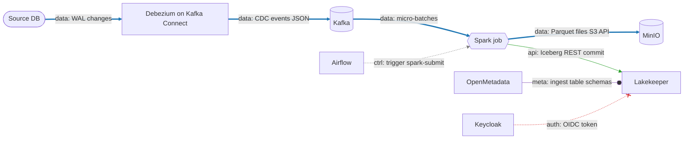
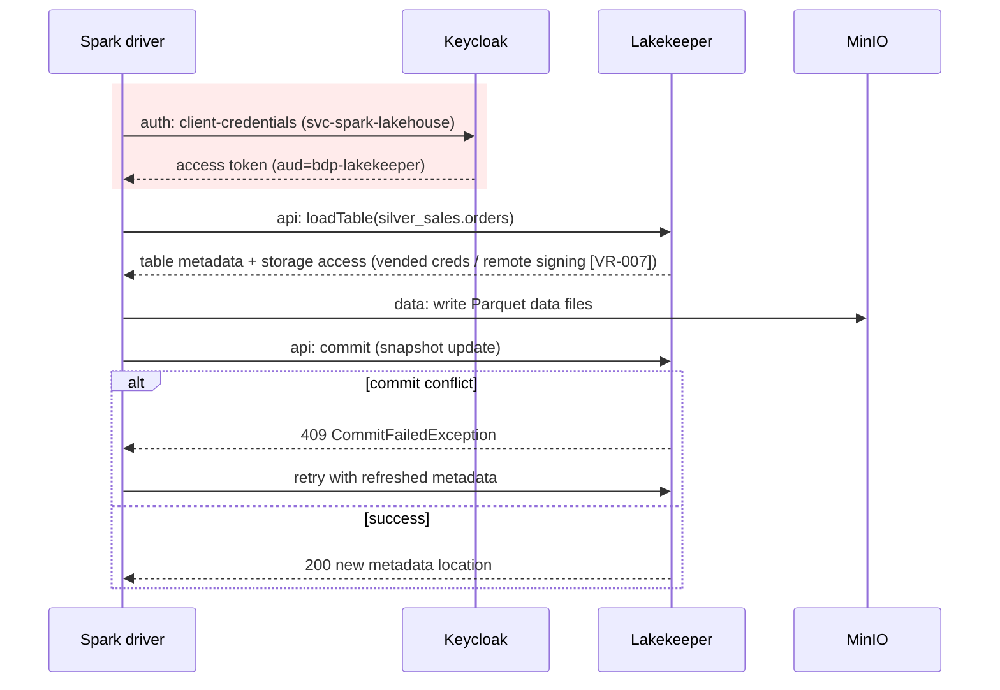
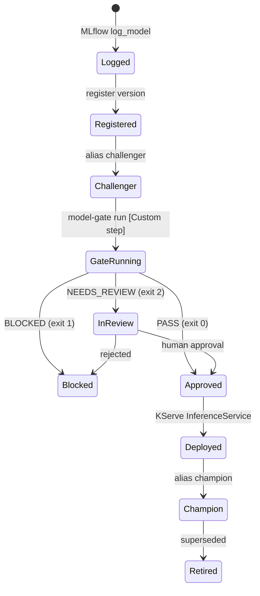

# 04: Documentation Templates and Authoring Standards

This file defines the fixed templates for Parts II–IV, the claim-tagging rules that keep native and custom capabilities distinct, and the diagram legend that distinguishes data, control, API, metadata, authentication and model-lifecycle flows.

---

## 1. Claim-Tagging Rules

Every capability or integration statement carries **one** of these tags at first mention in a section:

| Tag | Meaning | Example |
|-----|---------|---------|
| `[Native]` | Built into the component at the reference version, documented officially | Trino's Iceberg connector with `iceberg.catalog.type=rest` `[Native]` |
| `[Connector]` | Supplied by an official plugin/provider/contrib module of a baseline component (state which) | Feast Trino offline store `[Connector – contrib]` |
| `[Config]` | Native capability that only works with specific configuration | Debezium PostgreSQL source requires `wal_level=logical` `[Config]` |
| `[Custom]` | Platform code the implementer must write and own | model-gate → MLflow alias promotion step `[Custom]` |
| `[Prerequisite]` | Required runtime dependency outside the baseline (per ADR-015) | cert-manager for KServe webhooks `[Prerequisite]` |
| `[VR-nnn]` | Statement depends on an open validation item | ClickHouse writes to Iceberg `[VR-008]` |
| `[Optional]` / `[Conditional]` / `[Deployment-specific]` | Integration is not always present | TrustyAI explainer sidecar `[Optional]` |

**Never** describe a `[Custom]` integration in language that implies it is native ("X integrates with Y" → "the platform integrates X with Y via a custom step").

---

## 2. Component Specification Template (Part II)

Use exactly these headings for every component. Keep sections short; push detail into tables and examples.

```markdown
# <Component Name> — Component Specification

> **Reference version:** <from file 01> · **Layer:** <layer> · **Namespace:** <from file 02>
> **Official docs:** <link> · **Open validation items:** <VR list>

## 2.1 Identity and Purpose
- **What it is:** one sentence.
- **Problem solved:** one or two sentences.
- **Platform role:** what it is used for *in this platform* (not in general).
- **Architectural layer:** <layer>.
- **Responsibilities owned:** bullet list (3–6 items).

## 2.2 Functional Capabilities
| Capability | What a developer can do | Platform operation enabled | Tag |
|---|---|---|---|

## 2.3 Internal Architecture and Operating Model
- **Core services/modules:** table (service · role · stateful?).
- **Runtime architecture:** process model, scaling unit, HA model.
- **Processing/execution model:** e.g. MPP pipeline, micro-batch, request/response.
- **Storage/persistence model:** what is persisted, where, format.
- **APIs and service interfaces:** summary (full detail in 2.6).
- **Communication protocols:** HTTP/gRPC/Kafka protocol/JDBC/CQL/S3, TLS.
- **Configuration and extension mechanisms:** config files, plugins, SPIs.
- Diagram: internal architecture (Mermaid, per §5).

## 2.4 Inputs, Processing and Outputs
| Direction | What | Format | From / To | Consumed by |
|---|---|---|---|---|
| Input | | | | |
| Output | | | | |

## 2.5 Platform Responsibilities and Boundaries
| Manages | Does NOT manage | Owned instead by | Depends on (platform capability) |
|---|---|---|---|

## 2.6 Developer Interfaces and Configuration
- REST APIs (base path, key endpoints, auth)
- SDKs/libraries (package, version pin)
- CLI
- SQL interface (dialect notes)
- Connectors/drivers (JDBC URL format, client libs)
- Configuration files (path, key parameters table: parameter · purpose · example)
- Environment variables
- Service endpoints and ports (from file 02)
- Authentication and authorisation requirements (Keycloak/OpenBao specifics)
- **Practical examples** (minimum: one config snippet + one usage snippet)

## 2.7 Operational Considerations
| Topic | Guidance |
|---|---|
| Deployment dependencies | |
| Scalability | |
| Performance tuning | |
| Fault tolerance / HA | |
| Monitoring (metrics, key alerts) | |
| Logging | |
| Troubleshooting (top 5 symptoms → cause → fix) | |
| Maintenance / upgrades | |

## References
- Official documentation links (version-specific where possible)
```

---

## 3. Integration Specification Template (Part III)

```markdown
# INT-<nnn>: <Source> → <Target> — <Purpose in ≤ 6 words>

| Field | Value |
|---|---|
| Integration ID | INT-<nnn> |
| Nature | Native / Connector / Custom / Mixed |
| Optionality | Required / Optional / Conditional / Deployment-specific |
| Direction & initiator | <who initiates> → <who receives> |
| Mediation | Direct / Mediated by <component> |
| Mechanism | REST / JDBC / Kafka / S3 API / Iceberg REST / SQL / SDK / Webhook / Custom |
| Reference versions | <source ver> ↔ <target ver> |
| Open validation | <VR list> |

## A. Integration Purpose
- Why necessary · capability enabled · responsibility of each side.

## B. Integration Architecture
- Initiator, receiver, mediation, communication sequence.
- Sequence diagram (Mermaid, per §5.3).

## C. Technical Integration Mechanism
- Exact protocol/API/connector, endpoints, libraries.

## D. Data and Information Exchange
| Exchanged item | Format / schema | Transfer method | Request/response handling |
|---|---|---|---|
- Failure behaviour: what happens when the interaction fails.

## E. Configuration and Dependencies
| Prerequisite | Detail |
|---|---|
| Endpoints | |
| Credentials & auth | (Keycloak client, OpenBao path) |
| Network | (namespaces, ports, policies) |
| Service configuration | |
| Libraries / connectors | (with versions) |
| Permissions & policies | |
| Version compatibility | (CC-xx refs) |

## F. Developer Implementation
- Config snippet(s), code snippet(s), SQL, YAML manifest(s), API call(s).

## G. Failure and Troubleshooting
| Symptom | Likely cause | Diagnosis | Fix / retry / recovery |
|---|---|---|---|
```

---

## 4. Workflow Template (Part IV)

```markdown
# WF-<nn>: <Workflow Name>

## 1. Objective
## 2. Components Involved
## 3. Component Responsibilities
| Component | Responsibility in this workflow |
|---|---|
## 4. End-to-End Execution Sequence
- Numbered steps + sequence diagram.
## 5. Data Movement and Transformation
- Source → stages → targets; formats and schemas at each hop.
## 6. Control and Orchestration Flow
- What triggers what; scheduling; dependencies.
## 7. Integration Mechanisms per Stage
| Stage | Integration (INT-nnn) | Mechanism |
|---|---|---|
## 8. Security and Governance Enforcement
- AuthN/AuthZ per hop; secrets; data classification; quality gates; lineage capture.
## 9. Monitoring and Error Handling
- Metrics, alerts, retries, DLQs, idempotency, recovery.
## 10. Expected Outputs and Outcomes
```

---

## 5. Diagram Standards (Mermaid)

### 5.1 Flow-type legend

Every architecture diagram uses **both** the edge style and the label prefix, so the meaning survives renderers that ignore colours.

| Flow type | Mermaid edge | Mandatory label prefix | Colour (linkStyle) |
|-----------|-------------|------------------------|--------------------|
| Data flow | `==>` (thick) | `data:` | `#1f77b4` (blue) |
| Control / orchestration | `-.->` (dotted) | `ctrl:` | `#7f7f7f` (grey) |
| API interaction (request/response) | `-->` (solid) | `api:` | `#2ca02c` (green) |
| Metadata flow | `--o` (circle head) | `meta:` | `#9467bd` (purple) |
| Authentication / authorisation | `-.-x` (dotted, cross head) | `auth:` | `#d62728` (red) |
| Model lifecycle transition | Use `stateDiagram-v2` (separate diagram) | — | — |

Node shapes: `[(Store)]` for data stores, `[Service]` for services, `{{Job}}` for batch/ephemeral jobs, `([External])` for external systems.

### 5.2 Example: architecture diagram



### 5.3 Sequence diagrams

| Interaction | Arrow |
|-------------|-------|
| Synchronous request | `->>` |
| Response | `-->>` |
| Asynchronous event / message | `-)` |
| Auth steps | Wrap in `rect rgb(255,235,235)` block, labelled `auth:` |
| Failure path | `alt` / `else` blocks |



### 5.4 Model lifecycle diagrams



---

## 6. Writing Standards

1. **Implementation over description:** each section must answer "what do I configure, call or write?"
2. **One source of truth:** versions from file 01, names and ports from file 02. Never restate a different value.
3. **Code examples:** must be runnable or clearly marked `# illustrative`. Include version pins and namespace/host per conventions. No secrets inline; reference OpenBao paths.
4. **Links:** official documentation for the reference version at the end of every spec.
5. **Terminology:** use the glossary terms consistently: *warehouse* (Lakekeeper), *catalog* (engine-side name), *namespace* (Iceberg), *topic*, *feature view*, *registered model*, *alias*, *InferenceService*.
6. **No marketing language.** Limitations and trade-offs are stated explicitly.
