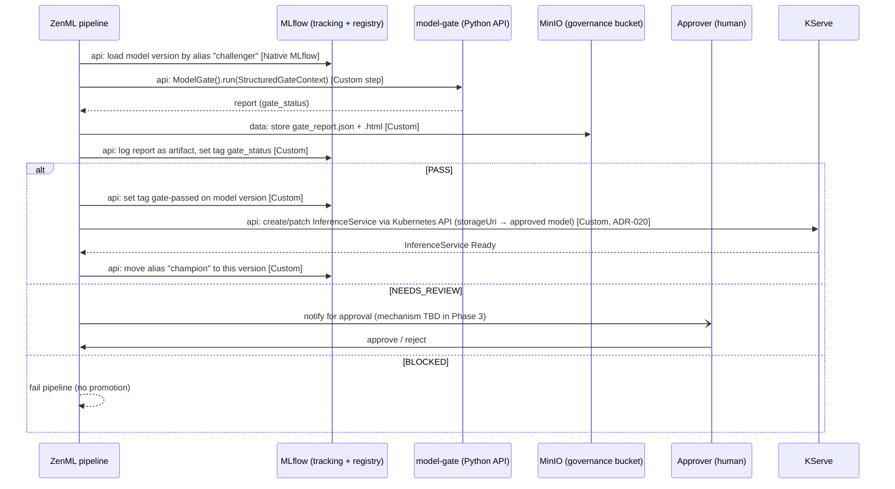

# 05: model-gate Capability Record

## 1. Purpose of This Record

The brief says the official package documentation is the source of truth for model-gate, and that features and integrations must not be invented. This record captures **only what the published package documentation states** (PyPI release pages for 0.5.2 and 0.7.0). It separates that from the **platform integration pattern**, which is custom code the platform must provide.

**Sources:**
- PyPI 0.7.0: https://pypi.org/project/bdp-model-gate/0.7.0/
- PyPI 0.5.2 (release history): https://pypi.org/project/bdp-model-gate/0.5.2/
- Project URLs listed on PyPI: repository https://github.com/vanjy-eng/model-gate · docs https://vanjy-eng.github.io/model-gate/docs/ · changelog and roadmap in the repository

> **Not yet reviewed:** the GitHub repository README and the hosted documentation site could not be fetched during Phase 0 (rate limit / access restriction). Statements below rely on the PyPI project description. Reviewing the hosted docs and repository README is a **Phase 2 (MLOps batch) action** that must be done before Workflow 12 is finalised.

---

## 2. Identity

| Field | Value (as published) |
|-------|---------------------|
| What it is | An automated **pre-deployment governance gate** for ML models covering fairness, performance, compliance, security and validation-methodology checks, plus a champion comparison for replacements |
| Output | One overall status: **`PASS` / `NEEDS_REVIEW` / `BLOCKED`**, intended to be wired into CI before promotion to production |
| Scope | **Structured data**: binary classification, multiclass (including ordinal), regression. Unstructured support (text/image/audio) is planned (`bdp_model_gate.unstructured` interface reserved). |
| Python | ≥ 3.9 |
| Licence | **MIT**, as published by the owner (ADR-024). The brief's "proprietary" means a platform-specific governance component, not a licensing restriction. |
| Author / maintainer | Vangelis Oden (one maintainer listed) |
| Release history | 0.2.0 (2026-08-26) → … → 0.5.2 (2026-09-01) → 0.6.0 (2026-09-11) → **0.7.0 (2026-10-15)** |
| Roadmap | 0.7.1/0.7.2 bug fixes (exposure-weighted intervals, multiclass column order) → 0.8.0 release automation via Trusted Publishing → 1.0.0 public subclassable `ModelAdapter` → unstructured data |

---

## 3. Installation

| Command | Contents |
|---------|---------|
| `pip install bdp-model-gate` | Core: contexts, reports, gate, checks that need no ML libraries |
| `pip install "bdp-model-gate[structured]"` | Adds fairlearn, shap, scikit-learn. **Required for real use.** |
| `pip install "bdp-model-gate[plots]"` | matplotlib, seaborn for charts in the HTML report |
| Other extras | `dev`, `yaml`, `toml`, `lint`, `mutation` |

Core-only installs fall back from `metric="auto"` to `accuracy` with a warning.

**Platform pin:** `bdp-model-gate[structured,plots,yaml]==0.7.0`, mirrored and hash-pinned in an internal index, because releases currently have no provenance attestations.

---

## 4. Interfaces

### 4.1 Python API (documented surface)

| Element | Role |
|---------|------|
| `StructuredGateContext` | Inputs: `model`, validation data (`X`, `y_true`, `y_pred`), optional `protected_df` (enables fairness checks), `X_train` (enables split-overlap and drift checks), `latencies_ms` (performance), `cost_per_inference`, `model_card` (compliance), `generate_fn` (prompt-injection testing of a generative side-car) |
| `ModelGate(checks=…)` | Runs a list of checks; `ModelGate().run(context)` returns a report |
| Report object | `summary()`, `to_json()`, `to_html()`, `gate_status` |
| `run_structured_gate(model, X, y, y_pred, protected_df=…)` | One-line convenience |
| `GateConfig` | Sections: `performance` (metric, min_score, decision_threshold, max_error, average), `fairness` (disparity_threshold, min_group_size), `uncertainty`, `security` |
| `default_structured_checks(config, include_plugins=True)` | Builds the standard check list; auto-loads plugins |
| `BaseCheck` | Subclass for custom checks (name, category, blocking flag) |
| `Champion.from_file(path, sha256=…)`, `Champion.from_loader("pkg.module:factory")`, `Champion(predictions=…)` | Champion definition for replacement comparisons |

Illustrative usage (structure from the published quickstart; confirm exact signatures against the hosted docs before publishing):

```python
# illustrative — confirm signatures against bdp-model-gate 0.7.x docs
from bdp_model_gate import StructuredGateContext, ModelGate

context = StructuredGateContext(
    model=candidate_model,
    X=X_val,
    y_true=y_val,
    y_pred=candidate_model.predict(X_val),
    protected_df=protected_val,     # optional: fairness checks
    X_train=X_train,                # optional: split-overlap and drift checks
    latencies_ms=benchmark_ms,      # optional: performance checks
    model_card=model_card_dict,     # optional: compliance checks
)

report = ModelGate().run(context)
print(report.summary())
if report.gate_status == "BLOCKED":
    raise SystemExit("Model failed governance gate — see gate_report.json")
```

### 4.2 CLI

Installing the package provides a `bdp-model-gate` console script intended as a **pre-deployment step**, run once per model before promotion (not on every PR).

| Flag group | Flags |
|-----------|-------|
| Model input | `--model`, `--model-loader` (`module:function`) |
| Data | `--data`, `--target-col`, `--protected`, `--task`, `--class-order`, `--favourable-classes` |
| Actuarial | `--expected-loss-col`, `--exposure-col`, `--baseline-col` |
| Thresholds | `--metric`, `--min-score`, `--decision-threshold`, `--max-error` (override the config file) |
| Compliance / cost | `--model-card`, `--cost-per-inference` |
| Champion | `--champion`, `--champion-sha256` |
| Output / config | `--output`, `--config` (JSON; YAML needs pyyaml; TOML needs tomli on Python < 3.11), `-v` |

**Exit codes (CI contract):**

| Exit code | Status | CI behaviour in published examples |
|-----------|--------|------------------------------------|
| `0` | `PASS` | Proceed to deploy |
| `2` | `NEEDS_REVIEW` | Pause for manual approval |
| `1` | `BLOCKED` | Fail the pipeline |

Published CI examples: Azure Pipelines (`ci_examples/azure-pipelines.model-gate.yml`) and GitHub Actions.

---

## 5. Checks

| Category | Checks | Blocking? |
|----------|--------|-----------|
| Validation (reported first) | LeakageCheck, SplitOverlapCheck, ValidationStrategyCheck, FeatureContractCheck | Blocking |
| | FeatureDriftCheck | Non-blocking |
| Comparison (only with a champion) | ComparisonIntegrityCheck, ChallengerPerformanceCheck, ChallengerGuardrailCheck | Blocking |
| | SubgroupRegressionCheck, FairnessDeltaCheck, DecisionChurnCheck, OperationalDeltaCheck | Non-blocking (as documented) |
| Actuarial (pricing) | ActualVsExpectedCheck, RiskDiscriminationCheck, MonotonicityCheck | Blocking |
| | DislocationCheck | Non-blocking |
| Fairness: classification | ProxyCorrelation, DisparateImpact, ShapSubgroup, CounterfactualFlip, EqualisedOdds, SubgroupCalibration | Non-blocking (→ `NEEDS_REVIEW`) |
| Fairness: regression | LossRatioParity, GroupMeanGap, ErrorParity, CalibrationParity | Non-blocking |
| Performance | PerformanceThresholdCheck (metric score, p95 latency, cost per inference), CalibrationCheck | Blocking |
| Compliance | ComplianceMappingCheck | Blocking |
| Security | AdversarialRobustnessCheck, PIILeakageCheck, PromptInjectionCheck | Blocking |
| | ReportInjectionCheck (instruction-shaped text in feature names / model-card values) | Non-blocking |

### 5.1 Status logic

- Any blocking failure → **`BLOCKED`**. Non-blocking flags (e.g. fairness) → **`NEEDS_REVIEW`**.
- Twelve checks bootstrap confidence intervals: interval wholly on the failing side → flag; straddling the threshold → **`UNCERTAIN`** (non-blocking, human review); wholly on the passing side → `OK`.
- `config.uncertainty.on_uncertain` ∈ {`review` (default), `block`, `point`}; interval computation can be disabled.
- The published page **does not give the complete aggregation rule** across all statuses. Do not document one beyond the above.

### 5.2 Performance metrics

- Built-in: `roc_auc`, `average_precision` (binary only), `accuracy`, `balanced_accuracy`, `f1`, `precision`, `recall`. Only `accuracy` works without scikit-learn.
- Label metrics binarise continuous predictions at `decision_threshold` (default 0.5). Custom metrics are callables `fn(y_true, y_pred)`.
- An explicitly named metric that cannot run gives a **blocking `CHECK_ERROR`**; a misspelled name raises `GateConfigurationError`. `min_accuracy` is deprecated in favour of `min_score`.

### 5.3 Champion comparison

- Default: **non-inferiority with a 1% margin**; `require="superior"` demands measurable improvement. Uses a paired bootstrap.
- Champion artefact formats: joblib/pkl, skops, onnx, keras. SHA-256 is verified **before** deserialisation; unpickling version warnings are treated as errors; mismatched label encodings block.

---

## 6. Outputs

| Output | Content |
|--------|---------|
| `gate_report.json` | Includes `gate_status`, `model_metric`, `model_score`, and `metric_is_fallback` in metadata (full schema not published on PyPI) |
| HTML report (`to_html()`) | Single self-contained file with inline SVG charts (14 check types can chart), print-friendly; charts degrade silently without `[plots]` |
| Process exit code | 0 / 2 / 1 as in §4.2 |

---

## 7. Supported Model Types

- scikit-learn, Keras, LightGBM and XGBoost (sklearn API), any object with `.predict()`.
- PyTorch, raw boosters and **remote endpoints** via `predict_fn`, `predict_proba_fn`, `gradient_fn`.
- Multiclass/ordinal via `task="multiclass"` and `class_order`.
- CLI loading via `--model-loader module:function`.

---

## 8. Extension (Plugins)

Third-party checks register under the entry-point group `bdp_model_gate.checks`:

```toml
[project.entry-points."bdp_model_gate.checks"]
my_check = "my_package.checks:MyCustomCheck"
```

`default_structured_checks()` loads them automatically unless `include_plugins=False`. Plugins that fail to load are logged and skipped. **Platform rule:** run with an explicit allow-list (or `include_plugins=False` plus explicit checks) so an unvetted plugin cannot silently change gate behaviour.

---

## 9. What Is NOT Documented (Do Not Claim)

| Topic | Published position | Guide treatment |
|-------|-------------------|-----------------|
| MLflow integration | Not mentioned | Platform glue `[Custom]` |
| ZenML integration | Not mentioned | Platform glue `[Custom]` (a ZenML step that calls the Python API) |
| KServe integration | Not mentioned | `[Custom]`. KServe endpoints may be evaluated via `predict_fn` (documented "remote endpoints" capability). |
| Kubernetes / operator / admission control | Not mentioned | Not claimed. The gate is a pipeline step, not an admission controller. |
| Model registries | Only generic "before promotion to a registry or prod endpoint" | `[Custom]` |
| LLM evaluation | Limited to prompt-injection testing of a generative side-car via `generate_fn` / `inject_fn` | State the limitation explicitly |
| Unstructured data | Not yet available | State as roadmap only |

---

## 10. Platform Integration Pattern (Accepted, Custom: ADR-017, ADR-020)

> Everything in this section is **platform design**, not model-gate functionality. Each step is `[Custom]` unless marked otherwise.



**Design rules for Workflow 12 (to be detailed in Phase 4):**

1. The gate runs **after registration as `challenger`** and **before any alias/tag that enables deployment**.
2. Deployment automation deploys **only** model versions carrying the `gate-passed` tag written by the governance step. This is a platform convention, not an MLflow or KServe feature.
3. The gate report is immutable evidence: stored in `bdp-<env>-governance` and linked from the MLflow model version.
4. Validation sets should have **≥ ~500 rows** to avoid widespread `UNCERTAIN` outcomes (documented limitation).
5. The champion is loaded with `Champion.from_file(..., sha256=...)` using the hash recorded at its own promotion.
